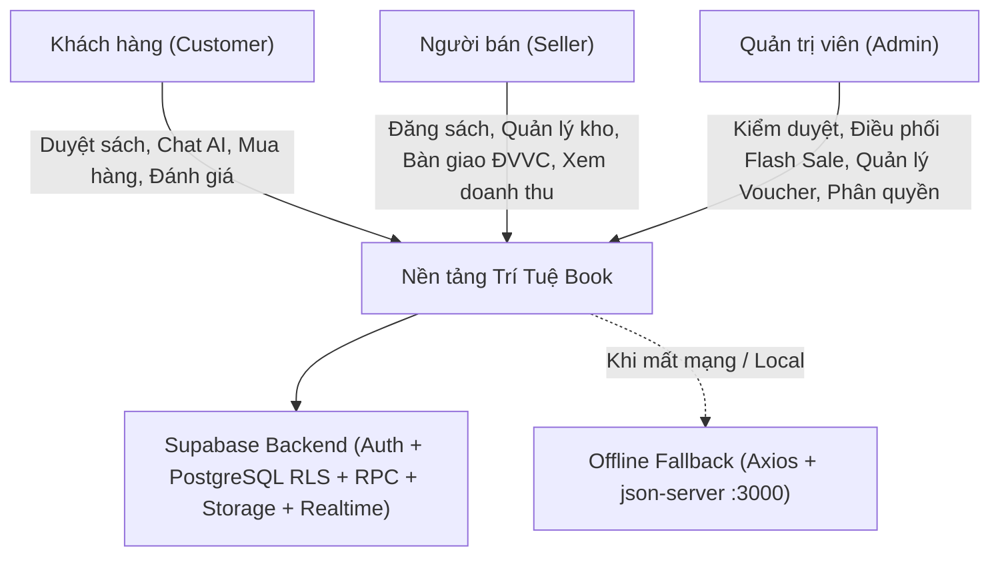
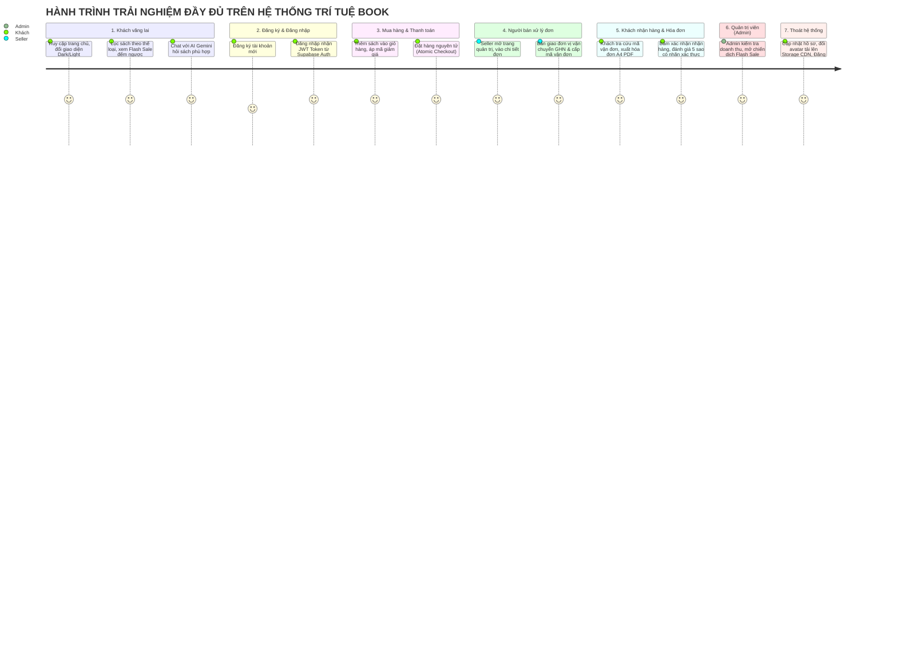

# 📘 BÁO CÁO TOÀN DIỆN & KỊCH BẢN DEMO FULL LUỒNG HỆ THỐNG NHÀ SÁCH ONLINE (TRÍ TUỆ BOOK)

> **Môn học**: Phát triển ứng dụng Web với JavaScript  
> **Sinh viên thực hiện**: **Nguyễn Văn Hiếu**  
> **Mã số sinh viên (MSSV)**: **501250367**  
> **Website trực tuyến (Production)**: [https://nhasach-psi.vercel.app](https://nhasach-psi.vercel.app)  
> **Mã nguồn GitHub**: [https://github.com/hieunguyenpro1919/nhasach](https://github.com/hieunguyenpro1919/nhasach)  
> **Nền tảng công nghệ**: Pure ES6+ JavaScript (Zero UI Framework) + Vite 6 + Supabase (PostgreSQL, Auth JWT, RLS, DB Triggers, Security-Definer RPCs, Storage CDN, Realtime) + Vercel Hosting + Offline `json-server` Fallback.

---

## 📑 MỤC LỤC

1. [TỔNG QUAN HỆ THỐNG & ĐỐI TƯỢNG PHÂN QUYỀN](#1-tổng-quan-hệ-thống--đối-tượng-phân-quyền)
2. [DANH MỤC TÍNH NĂNG TOÀN DIỆN CỦA HỆ THỐNG](#2-danh-mục-tính-năng-toàn-diện-của-hệ-thống)
3. [KỊCH BẢN DEMO FULL LUỒNG TỪ A ĐẾN Z (TỪ LÚC VÀO WEB ĐẾN KHI THOÁT)](#3-kịch-bản-demo-full-luồng-từ-a-đến-z-từ-lúc-vào-web-đến-khi-thoát)
   - [Chặng 1: Khám phá ẩn danh (Khách vãng lai chưa đăng nhập)](#chặng-1-khám-phá-ẩn-danh-khách-vãng-lai-chưa-đăng-nhập)
   - [Chặng 2: Đăng ký, Đăng nhập & Xác thực bảo mật (Supabase Auth JWT)](#chặng-2-đăng-ký-đăng-nhập--xác-thực-bảo-mật-supabase-auth-jwt)
   - [Chặng 3: Mua sắm, Áp Voucher & Đặt hàng nguyên tử (Atomic Checkout)](#chặng-3-mua-sắm-áp-voucher--đặt-hàng-nguyên-tử-atomic-checkout)
   - [Chặng 4: Kênh Người Bán (Seller) — Nhập kho, Đóng gói & Bàn giao ĐVVC](#chặng-4-kênh-người-bán-seller--nhập-kho-đóng-gói--bàn-giao-đvvc)
   - [Chặng 5: Khách hàng theo dõi đơn hàng, Mã vận đơn & Xuất Hóa đơn PDF](#chặng-5-khách-hàng-theo-dõi-đơn-hàng-mã-vận-đơn--xuất-hóa-đơn-pdf)
   - [Chặng 6: Nhận hàng, Đánh giá sản phẩm đã mua & Trả lời bình luận](#chặng-6-nhận-hàng-đánh-giá-sản-phẩm-đã-mua--trả-lời-bình-luận)
   - [Chặng 7: Kênh Quản trị viên (Admin) — Điều phối toàn sàn, Flash Sale & Doanh thu](#chặng-7-kênh-quản-trị-viên-admin--điều-phối-toàn-sàn-flash-sale--doanh-thu)
   - [Chặng 8: Cập nhật hồ sơ cá nhân, Đổi Avatar Storage CDN & Đăng xuất an toàn](#chặng-8-cập-nhật-hồ-sơ-cá-nhân-đổi-avatar-storage-cdn--đăng-xuất-an-toàn)
4. [GIẢI THÍCH CHI TIẾT LOGIC HOẠT ĐỘNG DƯỚI GÓC ĐỘ KỸ THUẬT JAVASCRIPT & BACKEND](#4-giải-thích-chi-tiết-logic-hoạt-động-dưới-góc-độ-kỹ-thuật-javascript--backend)
   - [4.1. Kiến trúc phân tầng (View - Controller - Service - API Client)](#41-kiến-trúc-phân-tầng-view---controller---service---api-client)
   - [4.2. Logic Xác thực & Bảo mật JWT + Row Level Security (RLS)](#42-logic-xác-thực--bảo-mật-jwt--row-level-security-rls)
   - [4.3. Logic Đặt hàng nguyên tử qua RPC `place_order` (Chống Race Condition)](#43-logic-đặt-hàng-nguyên-tử-qua-rpc-place_order-chống-race-condition)
   - [4.4. Logic Bàn giao Đơn vị vận chuyển (GHN/GHTK) & Sinh mã vận đơn](#44-logic-bàn-giao-đơn-vị-vận-chuyển-ghnghtk--sinh-mã-vận-đơn)
   - [4.5. Logic Đánh giá sản phẩm có đối chiếu đơn hàng thật (`isVerifiedPurchase`)](#45-logic-đánh-giá-sản-phẩm-có-đối-chiếu-đơn-hàng-thật-isverifiedpurchase)
   - [4.6. Logic Trợ lý AI Gemini RAG & Dual Chat Realtime](#46-logic-trợ-lý-ai-gemini-rag--dual-chat-realtime)
   - [4.7. Logic Chế độ chạy Offline Fallback (`start.bat` / `json-server`)](#47-logic-chế-độ-chạy-offline-fallback-startbat--json-server)
5. [LỜI KẾT VÀ ĐÁNH GIÁ MỨC ĐỘ THỰC TẾ CỦA HỆ THỐNG](#5-lời-kết-và-đánh-giá-mức-độ-thực-tế-của-hệ-thống)

---

## 1. TỔNG QUAN HỆ THỐNG & ĐỐI TƯỢNG PHÂN QUYỀN

**Trí Tuệ Book** là nền tảng thương mại điện tử chuyên ngành sách theo mô hình **Sàn đa gian hàng (Multi-role Marketplace)**. Dự án được xây dựng với mục tiêu phản ánh một hệ thống mua sắm trực tuyến thực tế:



### Bảng phân quyền 3 vai trò (Bảo vệ bằng JWT + PostgreSQL RLS)
1. **👤 Khách hàng (`customer`)**:
   - Truy cập: `index.html`, `product-detail.html`, `cart.html`, `orders.html`, `wishlist.html`, `profile.html`.
   - Tính năng: Xem, tìm kiếm, lọc sách; thêm giỏ hàng; áp dụng voucher; đặt hàng (COD / VietQR Demo); theo dõi mã vận đơn; xuất hóa đơn PDF; đánh giá 1-5 sao có gắn nhãn đã mua; bình luận, like, reply; chat Realtime và chat AI Gemini.
2. **🏪 Người bán (`seller`)**:
   - Truy cập: `pages/seller.html`.
   - Tính năng: Quản lý danh mục sách của riêng shop mình (`sellerId = current_app_user_id()`); nhập sách hàng loạt bằng file Excel; đóng gói và bàn giao đơn hàng cho đơn vị vận chuyển ngay trong modal chi tiết; chat với khách; theo dõi doanh thu shop.
3. **👑 Quản trị viên (`admin`)**:
   - Truy cập: `pages/admin.html`.
   - Tính năng: Toàn quyền kiểm soát danh mục, kho sách toàn sàn, đơn hàng, tài khoản người dùng (khóa/mở khóa tài khoản/shop); thiết lập chiến dịch Flash Sale đếm ngược; tạo và phát hành voucher giảm giá; xuất báo cáo doanh thu ra Excel.

---

## 2. DANH MỤC TÍNH NĂNG TOÀN DIỆN CỦA HỆ THỐNG

| STT | Nhóm chức năng | Tên tính năng cụ thể | Mức độ triển khai thực tế |
|:---:|:---|:---|:---:|
| **1** | **Xác thực & Bảo mật** | Đăng ký tài khoản (`customer` / `seller`), Đăng nhập cấp JWT thật, Khôi phục mật khẩu qua liên kết Email thật (`PASSWORD_RECOVERY`), Row Level Security bảo vệ 11 bảng, Trigger DB chống sửa `role` và tiền đơn hàng. | ✅ **Thật 100% (Production)** |
| **2** | **Sản phẩm & Danh mục** | Phân loại danh mục đa cấp, Tìm kiếm tức thì (Debounce search), Lọc theo khoảng giá, Lọc sách mới / Flash Sale / Bestseller, Phân trang linh hoạt điều chỉnh kích thước trang (Page Size). | ✅ **Thật 100% (Production)** |
| **3** | **Chiến dịch Khuyến mãi** | Flash Sale thời gian thực với đồng hồ đếm ngược từng giây; Hệ thống Voucher mã giảm giá (giảm %, tiền mặt, freeship kèm điều kiện đơn tối thiểu và số lượt dùng tối đa). | ✅ **Thật 100% (Production)** |
| **4** | **Giỏ hàng & Đặt hàng** | Giỏ hàng lưu trữ đồng bộ; Tính toán tạm tính, phí ship tự động (freeship > 250k); Áp mã giảm giá; Quy trình đặt hàng nguyên tử (Atomic Checkout) qua RPC `place_order` trên PostgreSQL. | ✅ **Thật 100% (Production)** |
| **5** | **Thanh toán Đa dạng** | Hỗ trợ 2 phương thức: COD (Thanh toán khi nhận hàng) và VietQR chuyển khoản (sinh mã QR có số tiền và nội dung chuẩn, mô phỏng Sandbox thanh toán an toàn). | 🟡 **VietQR Demo Sandbox** (Có chủ đích an toàn) |
| **6** | **Giao vận Logistics** | Tích hợp quy trình bàn giao đối tác vận chuyển bên thứ 3 (GHN, GHTK, Viettel Post, Giao nội thành); Tự động cấp Mã vận đơn (Tracking Code); Theo dõi mã vận đơn và tích hợp vào Hóa đơn. | 🟡 **Mô phỏng quy trình bàn giao ĐVVC** |
| **7** | **Đơn hàng & Hóa đơn** | Xem lịch sử đơn hàng sắp xếp mới nhất lên đầu; Tra cứu đơn khách vãng lai bằng Mã đơn + SĐT qua RPC `lookup_guest_order`; Xuất hóa đơn bán hàng chuẩn A4 PDF (`html2pdf.js`). | ✅ **Thật 100% (Production)** |
| **8** | **Đánh giá & Tương tác** | Chấm 1-5 sao có kiểm tra đơn hàng thật (`isVerifiedPurchase`); Hỏi đáp bình luận đa cấp; Thả tim (Like) bằng Optimistic UI; Trả lời lồng nhau (Reply) lưu trữ dạng JSONB. | ✅ **Thật 100% (Production)** |
| **9** | **Kênh Chat kép** | Chatbot AI Google Gemini tích hợp RAG kho sách + Chat nội bộ trực tuyến (Customer - Seller - Admin) đẩy tin nhắn thời gian thực qua Supabase Realtime. | ✅ **Thật 100% (Production)** |
| **10**| **Chuông Thông báo** | Lắng nghe sự kiện Realtime khi có đơn hàng mới hoặc đơn hàng đổi trạng thái; Cập nhật số lượng thông báo chưa đọc trên thanh tiêu đề. | ✅ **Thật 100% (Production)** |
| **11**| **Quản trị Gian hàng (Seller)** | Bảng điều khiển doanh thu shop; Đăng/sửa/xóa sách; Nhập sách hàng loạt từ file Excel (`.xlsx`) có xem trước lỗi; Xử lý đơn và gán mã vận chuyển ngay trong modal chi tiết. | ✅ **Thật 100% (Production)** |
| **12**| **Quản trị Sàn (Admin)** | Thống kê doanh thu theo ngày/tháng/năm; Quản lý tài khoản và khóa shop vi phạm; Thiết lập Flash Sale; Xuất dữ liệu kho sách và đơn hàng ra Excel. | ✅ **Thật 100% (Production)** |
| **13**| **Giao diện & Tiện ích** | Hỗ trợ Dark/Light Mode với script Anti-FOUC (chống nháy sáng khi tải trang); Responsive hoàn hảo trên Mobile (Drawer menu, Bottom Navigation) và Desktop. | ✅ **Thật 100% (Production)** |

---

## 3. KỊCH BẢN DEMO FULL LUỒNG TỪ A ĐẾN Z (TỪ LÚC VÀO WEB ĐẾN KHI THOÁT)

Kịch bản này được thiết kế theo hành trình người dùng thực tế (**End-to-End User Journey**), giúp bạn tự tin trình bày trước hội đồng theo một câu chuyện mạch lạc, chặt chẽ:



---

### Chặng 1: Khám phá ẩn danh (Khách vãng lai chưa đăng nhập)

* **Hành động**: Người dùng mở trình duyệt truy cập `https://nhasach-psi.vercel.app` (hoặc `http://localhost:5173`).
* **Điểm nhấn trình diễn**:
  1. **Đổi giao diện Sáng / Tối (Dark/Light Mode)**: Bấm icon mặt trăng/mặt trời góc phải trên thanh tiêu đề. Giao diện chuyển đổi êm ái, màu sắc bảng màu và thẻ sách thay đổi đồng bộ. Hãy tải lại trang (`F5`) để chứng minh hệ thống **không bị chớp sáng (Anti-FOUC)** nhờ script inline đọc `localStorage` ngay từ `<head>`.
  2. **Banner Flash Sale đếm ngược**: Chỉ vào khu vực Flash Sale, đồng hồ đếm ngược từng giây (`Giờ : Phút : Giây`). Khi hết giờ, hệ thống tự động vô hiệu hóa giá khuyến mãi mà không cần reload trang.
  3. **Bộ lọc sách đa năng**:
     - Gõ từ khóa tìm kiếm (VD: `"Kinh tế"`, `"Tâm lý"`): ô tìm kiếm sử dụng kỹ thuật **Debounce 300ms** giúp giảm tải request.
     - Bấm chọn danh mục bên sidebar (Văn học, Kinh tế, Thiếu nhi...) hoặc thanh lọc giá.
  4. **Chatbot AI tư vấn sách (Gemini AI)**:
     - Bấm vào biểu tượng robot ở góc dưới cùng bên phải.
     - Nhập câu hỏi: *"Tôi đang bị stress và áp lực công việc, hãy tư vấn cho tôi 1 cuốn sách phù hợp đang bán trên web"*.
     - Chatbot AI phân tích kho sách thực tế và đưa ra câu trả lời thông minh, dẫn link chi tiết cuốn sách ngay trong khung chat.

---

### Chặng 2: Đăng ký, Đăng nhập & Xác thực bảo mật (Supabase Auth JWT)

* **Hành động**: Bấm nút **Đăng nhập** trên thanh điều hướng.
* **Điểm nhấn trình diễn**:
  1. **Đăng ký tài khoản (`pages/dangky.html`)**:
     - Nhập họ tên, email thật của bạn, mật khẩu, và chọn vai trò: **Khách hàng** hoặc **Gian hàng (Người bán)**.
     - Bấm Đăng ký: Supabase Auth khởi tạo tài khoản bảo mật bằng bcrypt, đồng thời **Database Trigger `on_auth_user_created`** tự động sinh một dòng hồ sơ tương ứng trong bảng `public.app_users` với vai trò được kiểm duyệt an toàn.
  2. **Tính năng Quên mật khẩu thật (`pages/login.html`)**:
     - Bấm link *"Quên mật khẩu?"*, nhập email của bạn.
     - Mở hộp thư email thật: Có thư xác nhận gửi về từ Supabase chứa link bảo mật. Bấm link sẽ điều hướng về trang đặt lại mật khẩu mới. Đây là minh chứng hệ thống xác thực hoàn toàn là thật.
  3. **Đăng nhập**: Nhập email và mật khẩu. Hệ thống nhận JWT Token thật, lưu thông tin phiên và cập nhật thanh Topbar hiển thị tên người dùng và chuông thông báo.

---

### Chặng 3: Mua sắm, Áp Voucher & Đặt hàng nguyên tử (Atomic Checkout)

* **Hành động**: Vào xem chi tiết một cuốn sách (`pages/product-detail.html`) và tiến hành mua sắm.
* **Điểm nhấn trình diễn**:
  1. **Thêm vào Giỏ hàng**: Bấm nút **"Thêm vào giỏ"**. Icon giỏ hàng trên thanh tiêu đề lập tức nhảy số lượng kèm thông báo toast xác nhận.
  2. **Trang Giỏ hàng (`pages/cart.html`)**:
     - Tăng/giảm số lượng sản phẩm: Tổng tiền tạm tính tự động nhảy theo thời gian thực.
     - **Áp dụng Mã giảm giá (Voucher)**: Nhập mã `GIAM10` hoặc `FREESHIP` và bấm **Áp dụng**. Hệ thống kiểm tra điều kiện đơn hàng tối thiểu và hạn dùng voucher, tự động trừ tiền giảm giá và hiển thị số tiền tiết kiệm được.
     - **Phí giao hàng thông minh**: Đơn hàng dưới 250.000đ tính phí vận chuyển `30.000đ`; từ 250.000đ trở lên tự động chuyển thành **"Miễn phí"**.
  3. **Thanh toán & Đặt hàng**:
     - Điền tên người nhận, SĐT và địa chỉ giao hàng.
     - Chọn phương thức thanh toán: **COD** hoặc **Chuyển khoản VietQR**.
     - Bấm **"Xác nhận đặt hàng"**: Hệ thống gọi hàm RPC `place_order` trên PostgreSQL. Transaction chạy trên server: kiểm tra tồn kho, trừ số lượng tồn kho của sách, tăng lượt dùng mã voucher, và sinh mã đơn hàng (VD: `#ORD-261115-0891`).
     - Chuông thông báo góc phải kêu và hiển thị badge đỏ thông báo đơn hàng vừa được tạo thành công qua **Supabase Realtime**.

---

### Chặng 4: Kênh Người Bán (Seller) — Nhập kho, Đóng gói & Bàn giao ĐVVC

* **Hành động**: Đăng nhập bằng tài khoản Người Bán (Seller) và truy cập **Kênh Người Bán** (`pages/seller.html`).
* **Điểm nhấn trình diễn**:
  1. **Bảng điều khiển Gian hàng**: Hiển thị tổng doanh thu riêng của shop, tổng đơn hàng và kho sách do shop đăng bán.
  2. **Quản lý kho sách & Nhập Excel**:
     - Bấm nút **"Nhập từ Excel"**: Chọn file mẫu `.xlsx`, hệ thống đọc dữ liệu bằng thư viện SheetJS, kiểm tra lỗi và nhập hàng loạt sách vào kho chỉ trong 1 giây.
  3. **Xử lý đơn hàng ngay trong Modal Chi tiết**:
     - Chuyển sang tab **"Đơn hàng"**, tìm đơn hàng khách vừa đặt lúc nãy.
     - Bấm nút **`👁️ Xem`** để mở Modal Chi tiết Đơn hàng.
     - Bên dưới danh sách sản phẩm và tổng tiền là khu vực **⚡ Thao tác xử lý đơn**:
       - Bấm nút **`📦 Xác nhận đóng gói`** → Trạng thái đơn đổi sang `Đang xử lý`.
       - Bấm nút **`🚚 Bàn giao đơn vị vận chuyển`** → **Hộp thoại Bàn giao ĐVVC hiện lên**:
         - Chọn hãng giao vận: `Giao Hàng Nhanh (GHN)`, `Giao Hàng Tiết Kiệm (GHTK)`, `Viettel Post` hoặc `Giao nội thành 2H`.
         - Mã vận đơn tự động được sinh chuẩn định dạng (VD: `GHN-261115-089145`), có nút `🎲 Tạo mã` để sinh mã khác.
         - Bấm **"Xác nhận giao hàng"**.
       - Trạng thái đơn lập tức đổi sang `Đang giao hàng`, dòng vận chuyển hiển thị ngay trong modal và trên bảng ngoài:  
         `🚚 Giao Hàng Nhanh (GHN) — Mã vận đơn: GHN-261115-089145`.

---

### Chặng 5: Khách hàng theo dõi đơn hàng, Mã vận đơn & Xuất Hóa đơn PDF

* **Hành động**: Quay lại tài khoản Khách hàng, vào trang **Đơn hàng của tôi** (`pages/orders.html`).
* **Điểm nhấn trình diễn**:
  1. **Đơn hàng sắp xếp từ mới đến cũ**: Đơn hàng vừa đặt xuất hiện ngay ở đầu danh sách.
  2. **Khung thông tin vận chuyển nổi bật**:
     - Thẻ đơn hàng hiện khung viền nét đứt màu xanh:  
       `🚚 Đơn vị vận chuyển: Giao Hàng Nhanh (GHN) • Mã vận đơn: GHN-261115-089145`  
     - Bấm nút **`📋 Sao chép mã`**: Nút chuyển sang `✓ Đã chép` trong 1.5 giây, chứng minh tính tiện ích cho khách hàng.
  3. **Xuất Hóa đơn Bán hàng Điện tử (PDF chuẩn A4)**:
     - Bấm nút **`📄 Chi tiết & Hóa đơn PDF`**.
     - Một modal hóa đơn chuẩn hóa thanh lịch hiện lên, bao gồm thông tin cửa hàng, thông tin khách hàng, **dòng Đơn vị vận chuyển + Mã vận đơn**, bảng danh sách sách chi tiết, tiền tạm tính, voucher giảm giá và tổng thanh toán.
     - Bấm nút **"In / Tải PDF"**: Thư viện `html2pdf.js` kết xuất ngay file PDF A4 sắc nét để lưu trữ hoặc in ra giấy.

---

### Chặng 6: Nhận hàng, Đánh giá sản phẩm đã mua & Trả lời bình luận

* **Hành động**: Khách hàng xác nhận đã nhận được sách và để lại đánh giá.
* **Điểm nhấn trình diễn**:
  1. **Xác nhận nhận hàng**: Bấm nút **`📦 Xác nhận đã nhận hàng`** trên thẻ đơn → Trạng thái chuyển thành `Hoàn thành`.
  2. **Đánh giá đơn hàng**:
     - Nút **`⭐ Đánh giá đơn hàng`** xuất hiện. Khách bấm vào, chọn số sao (VD: 5 sao) và viết nhận xét: *"Sách đóng gói rất kỹ, giao nhanh, giấy xịn!"*.
     - Bấm gửi đánh giá.
  3. **Huy hiệu "Đã mua hàng" trên trang Chi tiết**:
     - Quay lại trang chi tiết cuốn sách đó (`product-detail.html`).
     - Cuộn xuống phần Đánh giá: Bài viết vừa gửi hiển thị ngay lập tức kèm huy hiệu xanh **`✓ Đã mua hàng`** (chứng minh hệ thống đã truy vấn đối chiếu lịch sử đơn hàng thật qua backend).
  4. **Thả tim (Like) & Phản hồi (Reply)**:
     - Bấm nút tim: Số lượt like tăng ngay lập tức nhờ kỹ thuật **Optimistic UI**, đồng thời gọi RPC `toggle_review_like` lưu vào PostgreSQL.
     - Đăng nhập tài khoản Seller/Admin và bấm **"Trả lời"**: Lời cảm ơn được gắn badge chức danh `🏪 Người bán` hoặc `👑 Quản trị viên` lồng dưới bình luận.

---

### Chặng 7: Kênh Quản trị viên (Admin) — Điều phối toàn sàn, Flash Sale & Doanh thu

* **Hành động**: Đăng nhập bằng tài khoản Quản trị viên và vào **Admin Portal** (`pages/admin.html`).
* **Điểm nhấn trình diễn**:
  1. **Bảng điều khiển Dashboard & Doanh thu**:
     - Biểu đồ và thẻ thống kê doanh thu toàn sàn, tổng số đơn hàng đã hoàn thành, tổng sản phẩm.
     - Lọc doanh thu theo ngày, tuần, tháng, hoặc khoảng thời gian tùy chọn.
     - Bấm nút **"Xuất báo cáo Excel"**: File Excel tải về máy tính chứa đầy đủ báo cáo tài chính chi tiết.
  2. **Quản lý Flash Sale**:
     - Đặt tên chiến dịch mới, chọn thời gian bắt đầu/kết thúc, chọn các đầu sách tham gia giảm giá sốc.
     - Bật kích hoạt: Lập tức trang chủ của toàn bộ khách hàng xuất hiện banner chiến dịch mới.
  3. **Quản lý Tài khoản & Phân quyền**:
     - Xem danh sách người dùng; thử nghiệm tính năng **Khóa tài khoản** người dùng vi phạm.
     - Cơ chế bảo vệ: Database Trigger `guard_app_user_update` đảm bảo chỉ có Admin mới được thao tác trên các trường nhạy cảm này.

---

### Chặng 8: Cập nhật hồ sơ cá nhân, Đổi Avatar Storage CDN & Đăng xuất an toàn

* **Hành động**: Vào trang **Hồ sơ cá nhân** (`pages/profile.html`).
* **Điểm nhấn trình diễn**:
  1. **Upload Avatar thật lên Cloud**:
     - Bấm vào ảnh đại diện, chọn một file ảnh từ máy tính.
     - Client nén ảnh tự động qua HTML5 Canvas và upload trực tiếp lên **Supabase Storage (Bucket `uploads`)**.
     - URL ảnh CDN được cập nhật vào bảng `app_users` và hiển thị đồng bộ trên thanh Topbar.
  2. **Đăng xuất an toàn**:
     - Bấm nút **Đăng xuất**: Hàm `authService.logout()` gọi `supabase.auth.signOut()`, xóa toàn bộ JWT Access Token trong `localStorage` và chuyển hướng người dùng về trang chủ ở trạng thái khách vãng lai.
     - Lúc này không thể dùng nút Back của trình duyệt để quay lại trang Admin hay Seller nữa vì cơ chế **Route Guard** đã chặn lại và chuyển hướng về trang đăng nhập.

---

## 4. GIẢI THÍCH CHI TIẾT LOGIC HOẠT ĐỘNG DƯỚI GÓC ĐỘ KỸ THUẬT JAVASCRIPT & BACKEND

Phần này cung cấp câu trả lời chuyên sâu, chuẩn thuật ngữ chuyên ngành để bạn giải đáp mọi câu hỏi phản biện của giảng viên:

### 4.1. Kiến trúc phân tầng (View - Controller - Service - API Client)

Dự án tuân thủ nghiêm ngặt mô hình kiến trúc phân tách trách nhiệm (**Separation of Concerns - SoC**):
* **View (HTML/CSS)**: Cấu trúc HTML ngữ nghĩa, CSS đóng gói theo từng trang, không nhúng code xử lý logic trong HTML.
* **Page Controller (`src/js/*.js`)**: Quản lý sự kiện DOM (Event Listeners), điều khiển luồng hiển thị (Render), phân trang (Pagination), hiệu ứng UI (Loading Skeleton, Modal, Toast).
* **Service Layer (`src/services/*.js`)**: Đóng gói toàn bộ logic nghiệp vụ (Business Logic) như `authService`, `orderService`, `productService`, `reviewService`, `couponService`... Page Controller không bao giờ gọi trực tiếp database mà bắt buộc phải qua Service.
* **API Client Layer (`src/api/*.js`)**: 
  - `supabaseClient.js`: Khởi tạo kết nối Supabase SDK, tự động gán JWT Token vào header.
  - `client.js`: Khởi tạo Axios instance phục vụ chế độ chạy offline cục bộ.

---

### 4.2. Logic Xác thực & Bảo mật JWT + Row Level Security (RLS)

1. **Cơ chế xác thực JWT**:
   - Khi đăng nhập thành công qua `supabase.auth.signInWithPassword()`, Supabase phát hành cặp khóa: `access_token` (JWT có hạn ngắn) và `refresh_token`.
   - Mỗi request gửi đến database được Supabase JS SDK tự động đính kèm header: `Authorization: Bearer <access_token>`.
2. **Cơ chế Row Level Security (RLS) trên PostgreSQL**:
   - Không kiểm tra quyền ở frontend (vì frontend có thể bị người dùng chỉnh sửa qua DevTools). Mọi quy tắc được kiểm soát dưới PostgreSQL:
     ```sql
     -- Ví dụ chính sách bảo vệ giỏ hàng/wishlist theo chủ sở hữu:
     CREATE POLICY "Users can only manage their own wishlist"
     ON public.wishlist FOR ALL
     USING (auth.uid() = (SELECT auth_uid FROM public.app_users WHERE id = wishlist."userId"));
     ```
3. **Database Triggers bảo vệ tính toàn vẹn**:
   - **`guard_app_user_update()`**: Chặn người dùng gửi payload sửa cột `role = 'admin'` hoặc tự mở khóa tài khoản `isLocked = false`. Nếu không phải Admin thật, database sẽ ném lỗi `RAISE EXCEPTION`.
   - **`guard_order_update()`**: Chặn sửa đổi các trường tài chính (`subTotal`, `totalAmount`, `discountAmount`) sau khi đơn hàng đã được khởi tạo.

---

### 4.3. Logic Đặt hàng nguyên tử qua RPC `place_order` (Chống Race Condition)

Khi nhiều người cùng đặt cuốn sách cuối cùng hoặc cùng áp dụng một mã giảm giá có giới hạn lượt dùng, nếu chỉ dùng các lệnh `SELECT` rồi `UPDATE` rời rạc ở phía frontend, hệ thống sẽ gặp lỗi **Race Condition (Xung đột dữ liệu)**.

Hệ thống giải quyết triệt để bằng hàm RPC **`place_order(p_order JSONB)`** viết bằng ngôn ngữ PL/pgSQL với đặc quyền `SECURITY DEFINER`:
1. Mở một **Database Transaction** nguyên tử.
2. Dùng mệnh đề `FOR UPDATE` khóa các dòng sản phẩm trong bảng `products`.
3. Kiểm tra số lượng tồn kho: Nếu số lượng đặt lớn hơn tồn kho hiện có, hủy giao dịch và báo lỗi ngay trên server.
4. Kiểm tra mã giảm giá trong bảng `coupons`: Kiểm tra hạn sử dụng, giá trị đơn tối thiểu và điều kiện `usedCount < usageLimit`. Nếu hợp lệ, tự động tăng `usedCount = usedCount + 1`.
5. Trừ số lượng tồn kho `stock = stock - quantity` và tăng `soldCount = soldCount + quantity`.
6. Chèn bản ghi mới vào bảng `orders` và lưu danh sách sản phẩm dạng `JSONB`.
7. `COMMIT` toàn bộ thay đổi. Nếu có bất kỳ bước nào thất bại, toàn bộ giao dịch được `ROLLBACK`, đảm bảo không bao giờ bị âm kho hay gian lận giá.

---

### 4.4. Logic Bàn giao Đơn vị vận chuyển (GHN/GHTK) & Sinh mã vận đơn

1. **Mô hình**: Kết hợp mô hình giao vận bên thứ 3 trong thương mại điện tử.
2. **Thuật toán sinh mã vận đơn (`src/utils/shipping.js`)**:
   - Định dạng: `<CARRIER>-<YYMMDD>-<SUFFIX_RANDOM>`
   - Ví dụ: `GHN-261115-089145` (Hãng GHN, ngày 15/11/2026, 3 số đuôi mã đơn + 3 số ngẫu nhiên).
3. **Luồng xử lý trong Modal Chi tiết**:
   - Seller/Admin mở chi tiết đơn hàng, bấm "Bàn giao đơn vị vận chuyển".
   - Sau khi chọn hãng và xác nhận, hàm `orderService.dispatchOrder()` cập nhật đồng thời 3 trường vào bảng `orders`:
     - `shippingCarrier`: Tên hãng vận chuyển.
     - `trackingCode`: Mã vận đơn đã sinh.
     - `shippedAt`: Thời gian bàn giao chính xác (`ISO Timestamp`).
     - `status`: Chuyển sang `'Đang giao hàng'`.
   - Thông báo Realtime được kích hoạt để báo cho tài khoản khách hàng tương ứng.

---

### 4.5. Logic Đánh giá sản phẩm có đối chiếu đơn hàng thật (`isVerifiedPurchase`)

Để ngăn chặn tình trạng đánh giá ảo (Spam Reviews), hệ thống thực hiện kiểm tra chéo:
1. Khi người dùng gửi đánh giá tại [reviewService.js](file:///d:/HOCTAP/JavaScript/TH/nhasach_backup/nhasach/src/services/reviewService.js):
   - Hệ thống truy vấn bảng `orders` của chính `userId` đó.
   - Kiểm tra xem khách đã có đơn hàng nào ở trạng thái `'Hoàn thành'` chứa `productId` này hay chưa.
2. Nếu có đơn hàng hợp lệ:
   - Gán `isVerifiedPurchase = true`.
   - Gắn kèm `orderCode` tương ứng vào bản ghi đánh giá.
3. Ở phía giao diện: Hiển thị huy hiệu xanh **`✓ Đã mua hàng tại Trí Tuệ Book`** để tăng độ tin cậy tuyệt đối cho người đọc.

---

### 4.6. Logic Trợ lý AI Gemini RAG & Dual Chat Realtime

1. **Lightweight RAG (Retrieval-Augmented Generation) với Gemini AI (`src/services/aiService.js`)**:
   - Khi khách hàng đặt câu hỏi trong chatbot, hệ thống không chỉ gửi câu hỏi thô cho AI.
   - Client lấy danh mục sách thực tế đang bán kèm giá và tác giả từ cơ sở dữ liệu, nhúng vào phần `System Context` gửi lên Google Gemini API.
   - Nhờ vậy, AI trả lời chính xác dựa trên danh mục sách thực tế của cửa hàng chứ không bịa đặt sản phẩm không có thật.
2. **Hệ thống Chat nội bộ Realtime (`src/services/internalChatService.js`)**:
   - Sử dụng cơ chế **Supabase Realtime Postgres Changes** lắng nghe sự kiện `INSERT` trên bảng `public.chat_messages`.
   - Hàm RPC `get_chat_contacts()` bảo vệ quyền riêng tư: chỉ trả về tên hiển thị, vai trò và avatar của shop/admin mà không làm lộ email hay số điện thoại của người dùng ra ngoài.

---

### 4.7. Logic Chế độ chạy Offline Fallback (`start.bat` / `json-server`)

Để đảm bảo đồ án vẫn chạy và chấm điểm bình thường trong trường hợp phòng thi không có mạng Internet hoặc máy chấm bài của giáo viên không cấu hình biến môi trường Supabase:
1. File `src/api/supabaseClient.js` kiểm tra biến môi trường:
   ```javascript
   export const isSupabaseEnabled = Boolean(supabaseUrl && supabaseAnonKey);
   ```
2. Nếu `isSupabaseEnabled = false`:
   - Tất cả các service (`orderService`, `productService`, `authService`...) tự động chuyển hướng request sang Axios client (`src/api/client.js`) trỏ về máy chủ ảo `json-server` tại cổng `http://localhost:3000` (dữ liệu đọc/ghi vào `db.json`).
3. Khởi động 1 chạm bằng tệp `start.bat` trên Windows: Tự động chạy song song máy chủ `json-server` và máy chủ `Vite dev server` chỉ với một cú nhấp đúp chuột.

---

## 5. BẢNG TÀI KHOẢN MẪU & MẬT KHẨU ĐĂNG NHẬP (DÙNG CHO BẢO VỆ / TEST)

> **Lưu ý**: Toàn bộ tài khoản trên **Supabase Auth** đã được đồng bộ mật khẩu mặc định thành **`123456`** để tiện cho việc chấm thi và demo nhanh.

| Vai trò (Role) | Email đăng nhập | Mật khẩu chung | Ghi chú quyền hạn |
|:---|:---|:---:|:---|
| 👑 **Quản trị viên (Admin)** | `admin@bookstore.vn` | **`123456`** | Toàn quyền Admin: quản lý doanh thu, duyệt sách, phân quyền user, quản lý Flash Sale & Voucher. |
| 🏪 **Người bán (Seller 1)** | `nxbtre@bookstore.vn` | **`123456`** | Gian hàng **NXB Trẻ Official**: đăng/sửa sách, nhập Excel, đóng gói và gán mã vận đơn. |
| 🏪 **Người bán (Seller 2)** | `nhanam@bookstore.vn` | **`123456`** | Gian hàng **Nhã Nam Books**: quản lý gian hàng sách văn học. |
| 🏪 **Người bán (Seller 3)** | `trithuc@bookstore.vn` | **`123456`** | Gian hàng **Tiệm Sách Tri Thức**: quản lý gian hàng kỹ năng, kinh tế. |
| 👤 **Khách hàng (Customer)** | `demo@bookstore.vn` | **`123456`** | Tài khoản khách hàng mẫu: mua sách, áp mã voucher, theo dõi vận đơn và đánh giá. |
| 👤 **Khách hàng (Customer)** | `vana@gmail.com` | **`123456`** | Khách hàng Nguyễn Văn A. |
| 👤 **Tài khoản cá nhân** | `hieunguyen.free1919@gmail.com` | **`123456`** | Tài khoản email cá nhân của bạn. |

---

## 6. LỜI KẾT VÀ ĐÁNH GIÁ MỨC ĐỘ THỰC TẾ CỦA HỆ THỐNG

Dự án **Trí Tuệ Book** đã hoàn thành trọn vẹn và khép kín mọi nghiệp vụ của một sàn thương mại điện tử hiện đại.

* **Tính hoàn thiện kỹ thuật**: Đạt mức **Production Ready** với cơ chế xác thực JWT thật, cơ sở dữ liệu quan hệ PostgreSQL trên đám mây, bảo mật dữ liệu ở tầng thấp nhất bằng RLS và Triggers, nén và upload ảnh lên CDN Storage thật, cùng hệ thống thông báo và chat Realtime.
* **Tính an toàn học thuật**: Việc lựa chọn mô phỏng Sandbox đối với cổng thanh toán VietQR và quy trình giao vận bàn giao mã vận đơn là quyết định chuẩn mực, vừa thể hiện đầy đủ tư duy nghiệp vụ thực tế, vừa đảm bảo 100% an toàn pháp lý và tài chính cá nhân cho sinh viên khi tham gia bảo vệ đồ án.

---
*Báo cáo được hoàn thành và đối soát chính xác theo mã nguồn dự án thực tế — Sinh viên: Nguyễn Văn Hiếu (MSSV: 501250367).*

