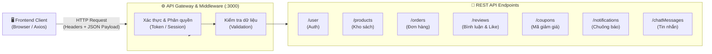

# 📡 RESTful API Specification & Design — Trí Tuệ Book

> [!NOTE]
> **Tài liệu đặc tả và thiết kế giao diện lập trình ứng dụng (RESTful API Specification)** cho hệ thống Website Thương mại điện tử Nhà sách Trí Tuệ Book.
> 
> **Sinh viên thực hiện:** Nguyễn Văn Hiếu — **MSSV:** 501250367  
> **Học phần:** Lập trình JavaScript (JavaScript Programming)  
> **Base URL:** `http://localhost:3000` (Axios Client Instance)  
> **Định dạng dữ liệu:** `application/json`

---

## 1. 🌐 Tổng Quan Kiến Trúc REST API

Hệ thống API được thiết kế tuân thủ nghiêm ngặt các nguyên lý **RESTful Architecture**:
- **Tài nguyên danh từ (Resource-oriented):** `/products`, `/orders`, `/reviews`, `/coupons`, `/user`...
- **Động từ HTTP chuẩn hóa (Standard HTTP Verbs):**
  - `GET`: Truy vấn và lấy dữ liệu tài nguyên (Idempotent).
  - `POST`: Khởi tạo mới tài nguyên.
  - `PUT`: Cập nhật toàn bộ thuộc tính của tài nguyên.
  - `PATCH`: Cập nhật cục bộ một phần thuộc tính tài nguyên (Optimistic Partial Update).
  - `DELETE`: Hủy bỏ / Xóa tài nguyên.
- **Không lưu trạng thái (Stateless):** Mỗi request mang đầy đủ thông tin định danh và ngữ cảnh cần thiết.



---

## 2. 🚦 Chuẩn Mã Phản Hồi HTTP (HTTP Status Codes)

| Mã trạng thái | Tên chuẩn | Ý nghĩa trong hệ thống |
|:---:|:---|:---|
| **`200 OK`** | Success | Yêu cầu xử lý thành công (Áp dụng cho `GET`, `PUT`, `PATCH`, `DELETE`). |
| **`201 Created`** | Created | Tạo mới tài nguyên thành công (Áp dụng cho `POST /orders`, `POST /reviews`...). |
| **`400 Bad Request`** | Client Error | Dữ liệu gửi lên không hợp lệ hoặc thiếu các trường bắt buộc. |
| **`401 Unauthorized`** | Auth Required | Người dùng chưa đăng nhập hoặc phiên làm việc hết hạn. |
| **`403 Forbidden`** | Access Denied | Người dùng không đủ quyền truy cập (Ví dụ: Khách cố tình gọi API xóa sách của Admin). |
| **`404 Not Found`** | Not Found | Không tìm thấy tài nguyên theo ID yêu cầu (Ví dụ: Cuốn sách không tồn tại). |
| **`500 Internal Error`**| Server Error | Lỗi hệ thống nội bộ máy chủ. |

---

## 3. 🔑 Authentication & Users API (Xác Thực & Tài Khoản)

### 3.1. Đăng ký tài khoản mới
- **Endpoint:** `POST /user`
- **Quyền hạn:** Công khai (`Public`)
- **Mô tả:** Đăng ký tài khoản người mua mới hoặc gian hàng người bán.

**Request Body (JSON):**
```json
{
  "name": "Nguyễn Văn Hiếu",
  "email": "hieu@gmail.com",
  "password": "hashed_or_plain_password",
  "role": "customer",
  "avatar": "",
  "phone": "0987654321",
  "address": "123 Nguyễn Văn Cừ, Quận 5, TP.HCM",
  "createdAt": "2026-11-05T08:00:00.000Z"
}
```

**Response `201 Created`:**
```json
{
  "id": 9,
  "name": "Nguyễn Văn Hiếu",
  "email": "hieu@gmail.com",
  "role": "customer"
}
```

---

### 3.2. Đăng nhập & Kiểm tra email
- **Endpoint:** `GET /user?email={email}`
- **Quyền hạn:** Công khai (`Public`)
- **Mô tả:** Truy vấn tài khoản theo email để kiểm tra mật khẩu hoặc phục vụ khôi phục tài khoản qua OTP.

**Response `200 OK`:**
```json
[
  {
    "id": 3,
    "name": "Nguyễn Văn A",
    "email": "vana@gmail.com",
    "role": "customer",
    "avatar": "data:image/png;base64,..."
  }
]
```

---

### 3.3. Cập nhật hồ sơ cá nhân / Đổi ảnh đại diện / Đổi mật khẩu
- **Endpoint:** `PATCH /user/:id`
- **Quyền hạn:** Chính chủ tài khoản (`Authenticated User`)
- **Mô tả:** Cập nhật các trường thông tin cá nhân: Họ tên, số điện thoại, địa chỉ, ảnh avatar (Base64) hoặc mật khẩu mới sau khi xác thực OTP.

**Request Body (JSON):**
```json
{
  "name": "Nguyễn Văn Hiếu",
  "phone": "0901234567",
  "avatar": "data:image/webp;base64,UklGRmYAAABXRUJQVlA4..."
}
```

**Response `200 OK`:** Trả về đối tượng người dùng với các trường đã cập nhật thành công.

---

## 4. 📚 Products API (Quản Lý Kho Sách)

### 4.1. Lấy danh sách sách (Hỗ trợ Lọc & Tìm kiếm)
- **Endpoint:** `GET /products`
- **Tham số truy vấn (Query Params):**
  - `categoryId`: Lọc theo mã danh mục thể loại (ví dụ: `?categoryId=1`).
  - `q`: Tìm kiếm từ khóa theo tên sách hoặc tác giả (ví dụ: `?q=Code`).
  - `sellerId`: Lọc sách do riêng gian hàng người bán đó quản lý.
  - `onSale`: Lọc các cuốn sách đang tham gia Flash Sale (`?onSale=true`).
- **Response `200 OK`:**
```json
[
  {
    "id": 1,
    "name": "Nhà Giả Kim (Tái Bản)",
    "categoryId": 1,
    "price": 79000,
    "stock": 45,
    "image": "/src/assets/books/nhagiakim.jpg",
    "author": "Paulo Coelho",
    "soldCount": 128,
    "onSale": true,
    "discountPercent": 25,
    "sellerId": 2,
    "sellerName": "Gian Hàng Tri Thức Trẻ",
    "status": "active"
  }
]
```

---

### 4.2. Lấy thông tin chi tiết một cuốn sách
- **Endpoint:** `GET /products/:id`
- **Response `200 OK`:** Trả về đối tượng sản phẩm chi tiết; Response `404 Not Found` nếu ID không tồn tại.

---

### 4.3. Thêm sách mới vào kho (Thủ công hoặc Import Excel)
- **Endpoint:** `POST /products`
- **Quyền hạn:** `Admin` hoặc `Seller`
- **Request Body (JSON):**
```json
{
  "name": "Clean Code - Mã Sạch",
  "categoryId": 2,
  "price": 215000,
  "stock": 50,
  "image": "/src/assets/books/cleancode.jpg",
  "author": "Robert C. Martin",
  "description": "Cẩm nang đắt giá dành cho lập trình viên chuyên nghiệp...",
  "sellerId": 2,
  "sellerName": "Gian Hàng Tri Thức Trẻ",
  "soldCount": 0,
  "onSale": false,
  "discountPercent": 0,
  "status": "active"
}
```
- **Response `201 Created`:** Trả về sách mới kèm `id` tự tăng.

---

### 4.4. Cập nhật sách / Nhập thêm tồn kho / Trừ kho khi mua
- **Endpoint:** `PATCH /products/:id`
- **Quyền hạn:** `Admin`, `Seller` hoặc Hệ thống Checkout
- **Request Body ví dụ:**
```json
{
  "stock": 43,
  "soldCount": 130
}
```
- **Response `200 OK`:** Trả về sách đã cập nhật.

---

### 4.5. Xóa sách khỏi hệ thống
- **Endpoint:** `DELETE /products/:id`
- **Quyền hạn:** `Admin` hoặc `Seller` sở hữu
- **Response `200 OK`:** `{}`

---

## 5. 🏷️ Categories API (Danh Mục Thể Loại)

| Phương thức | Endpoint | Quyền hạn | Mô tả chức năng |
|:---|:---|:---:|:---|
| `GET` | `/categories` | Public | Lấy toàn bộ danh sách các thể loại sách |
| `POST` | `/categories` | Admin | Tạo mới một thể loại sách |
| `PUT / PATCH` | `/categories/:id` | Admin | Chỉnh sửa tên hoặc icon thể loại |
| `DELETE` | `/categories/:id` | Admin | Xóa thể loại (Bảo vệ: Chặn xóa nếu còn sách) |

---

## 6. 📦 Orders API (Quản Lý Đơn Hàng & Mua Sắm)

### 6.1. Tạo đơn hàng mới (Checkout)
- **Endpoint:** `POST /orders`
- **Quyền hạn:** Khách hàng đã đăng nhập (`Customer`)
- **Mô tả:** Khởi tạo đơn hàng mới, lưu thông tin giao hàng, danh sách sản phẩm và phương thức thanh toán.

**Request Body (JSON):**
```json
{
  "orderCode": "TB-1730761234567",
  "userId": 3,
  "userEmail": "vana@gmail.com",
  "receiverName": "Nguyễn Văn A",
  "receiverPhone": "0912345678",
  "receiverAddress": "123 Lê Duẩn, Phường Bến Nghé, Quận 1, TP.HCM",
  "receiverNote": "Giao giờ hành chính giúp em",
  "items": [
    {
      "productId": 1,
      "productName": "Nhà Giả Kim (Tái Bản)",
      "price": 59250,
      "quantity": 2
    }
  ],
  "subTotal": 118500,
  "shippingFee": 25000,
  "totalAmount": 143500,
  "paymentMethod": "vietqr",
  "status": "pending",
  "createdAt": "2026-11-05T09:30:00.000Z"
}
```

**Response `201 Created`:** Trả về đơn hàng vừa tạo thành công kèm `id`.

---

### 6.2. Lấy danh sách đơn hàng
- **Endpoint:** `GET /orders`
- **Tham số:** 
  - `userId`: Khách hàng xem đơn của chính mình (`/orders?userId=3`).
  - Không truyền: Admin xem toàn bộ đơn hàng sàn để thống kê.
- **Response `200 OK`:** Mảng danh sách các đơn hàng.

---

### 6.3. Cập nhật trạng thái đơn hàng (Duyệt đơn / Hủy đơn)
- **Endpoint:** `PATCH /orders/:id`
- **Quyền hạn:** `Admin`, `Seller` hoặc `Customer` (chỉ được hủy khi đang `pending`).
- **Request Body (JSON):**
```json
{
  "status": "shipping"
}
```
*(Các trạng thái hợp lệ: `pending`, `confirmed`, `shipping`, `completed`, `cancelled`)*.

---

## 7. ⭐ Reviews, Comments & Replies API (Đánh Giá, Bình Luận & Tương Tác)

### 7.1. Lấy danh sách đánh giá & bình luận của một cuốn sách
- **Endpoint:** `GET /reviews?productId={productId}`
- **Quyền hạn:** Công khai (`Public`)
- **Response `200 OK`:**
```json
[
  {
    "id": 1,
    "productId": 1,
    "userId": 3,
    "userName": "Nguyễn Văn A",
    "rating": 5,
    "comment": "Cuốn sách rất hay, nội dung sâu sắc và truyền cảm hứng mạnh mẽ!",
    "likes": [3, 4],
    "replies": [
      {
        "id": 1730769999999,
        "userId": 2,
        "userName": "Gian Hàng Tri Thức Trẻ",
        "comment": "Cảm ơn bạn đã ủng hộ nhà sách ạ!",
        "createdAt": "2026-11-05T10:00:00.000Z"
      }
    ],
    "createdAt": "2026-11-04T12:00:00.000Z"
  }
]
```

---

### 7.2. Gửi bình luận & Đánh giá mới (Không chặn spam)
- **Endpoint:** `POST /reviews`
- **Quyền hạn:** Khách hàng đã đăng nhập (`Customer`)
- **Request Body (JSON):**
```json
{
  "productId": 1,
  "userId": 3,
  "userName": "Nguyễn Văn A",
  "rating": 5,
  "comment": "Sách giao nhanh, bọc cẩn thận, cho shop 5 sao!",
  "likes": [],
  "replies": [],
  "createdAt": "2026-11-05T10:15:00.000Z"
}
```
- **Response `201 Created`:** Bản ghi nhận xét mới.

---

### 7.3. Thích / Bỏ thích bình luận (Toggle Like)
- **Endpoint:** `PATCH /reviews/:id`
- **Quyền hạn:** Khách hàng đã đăng nhập
- **Mô tả:** Cập nhật lại mảng `likes` chứa danh sách các `userId` đã thích.

**Request Body (JSON):**
```json
{
  "likes": [3, 4, 9]
}
```
- **Response `200 OK`:** Trả về review với mảng likes mới.

---

### 7.4. Trả lời bình luận lồng nhau (Threaded Reply)
- **Endpoint:** `PATCH /reviews/:id`
- **Quyền hạn:** Khách hàng, Seller hoặc Admin
- **Mô tả:** Thêm một đối tượng câu trả lời mới vào mảng `replies` của bình luận cha.

**Request Body (JSON):**
```json
{
  "replies": [
    {
      "id": 1730771234567,
      "userId": 9,
      "userName": "Nguyễn Văn Hiếu",
      "comment": "Mình cũng rất đồng tình với quan điểm này của bạn!",
      "createdAt": "2026-11-05T10:30:00.000Z"
    }
  ]
}
```
- **Response `200 OK`:** Cập nhật thành công.

---

## 8. ❤️ Wishlist API (Sách Yêu Thích)

| Phương thức | Endpoint | Tham số / Body | Mô tả chức năng |
|:---|:---|:---|:---|
| `GET` | `/wishlist?userId={id}` | `userId` | Lấy toàn bộ sách người dùng đã thả tim |
| `POST` | `/wishlist` | `{ "userId": 3, "productId": 1 }` | Thêm sách vào bộ sưu tập yêu thích |
| `DELETE` | `/wishlist/:id` | `id` | Bỏ thích / Xóa sách khỏi wishlist |

---

## 9. 🎟️ Coupons API (Mã Giảm Giá)

### 9.1. Lấy và kiểm tra mã giảm giá
- **Endpoint:** `GET /coupons?code={code}&active=true`
- **Quyền hạn:** Public
- **Response `200 OK`:**
```json
[
  {
    "id": 1,
    "code": "TRIUE10",
    "description": "Giảm 10% cho đơn hàng từ 150.000đ",
    "discountType": "percent",
    "discountValue": 10,
    "minOrderValue": 150000,
    "maxDiscount": 50000,
    "active": true
  }
]
```

### 9.2. Quản lý mã giảm giá (Admin)
- `POST /coupons`: Tạo mã voucher mới.
- `PATCH /coupons/:id`: Bật/tắt kích hoạt mã (`active: false`).
- `DELETE /coupons/:id`: Xóa mã voucher.

---

## 10. 🔔 Notifications API (Chuông Thông Báo Đơn Hàng)

### 10.1. Lấy thông báo theo tài khoản
- **Endpoint:** `GET /notifications?userId={userId}&_sort=createdAt&_order=desc`
- **Response `200 OK`:**
```json
[
  {
    "id": 1,
    "userId": 3,
    "orderId": 5,
    "orderCode": "TB-1730761234",
    "title": "Đơn hàng đang được giao",
    "message": "Đơn hàng TB-1730761234 của bạn đã được giao cho bưu tá vận chuyển.",
    "isRead": false,
    "createdAt": "2026-11-05T08:45:00.000Z"
  }
]
```

### 10.2. Đánh dấu đã đọc thông báo
- **Endpoint:** `PATCH /notifications/:id`
- **Body:** `{ "isRead": true }`
- **Response `200 OK`:** Cập nhật thành công.

---

## 11. 💭 Internal Chat API (Khung Chat Nội Bộ)

### 11.1. Lấy lịch sử tin nhắn giữa 2 người dùng
- **Endpoint:** `GET /chatMessages?senderId={A}&receiverId={B}`
- **Ghi chú:** Client gọi song song 2 chiều (A gửi B và B gửi A) rồi gộp sắp xếp theo `timestamp`.

### 11.2. Gửi tin nhắn mới
- **Endpoint:** `POST /chatMessages`
- **Body:**
```json
{
  "senderId": 3,
  "senderName": "Nguyễn Văn A",
  "senderRole": "customer",
  "receiverId": 2,
  "receiverName": "Gian Hàng Tri Thức Trẻ",
  "message": "Shop ơi cuốn sách này còn bản bìa cứng không ạ?",
  "timestamp": "2026-11-05T11:00:00.000Z",
  "read": false
}
```
- **Response `201 Created`:** Lưu tin nhắn thành công.

---

## 12. ⚡ Flash Sale Campaign API (Cấu Hình Giảm Giá Giờ Vàng)

- **Endpoint:** `GET /saleConfig` và `PATCH /saleConfig/1`
- **Quyền hạn:** `Admin` (cấu hình) & `Public` (đọc thời gian đếm ngược)
- **Payload cấu hình:**
```json
{
  "isActive": true,
  "campaignName": "Lễ Hội Sách Giờ Vàng - Giảm Sốc Đến 50%",
  "startTime": "2026-11-05T00:00:00.000Z",
  "endTime": "2026-11-06T23:59:59.000Z",
  "durationHours": 48
}
```

---

## 🎯 13. Tổng Kết

Tài liệu thiết kế API trên:
1. Bao phủ **100% tất cả 14 tính năng cốt lõi và nâng cao** của dự án `nhasach`.
2. Định dạng Request / Response chuẩn JSON RESTful, đồng bộ hoàn hảo với các service trong mã nguồn [`src/services/`](file:///d:/HOCTAP/JavaScript/TH/nhasach/src/services/).
3. Sẵn sàng đóng gói và trình nộp cùng hồ sơ đồ án cho Giảng viên hướng dẫn!

