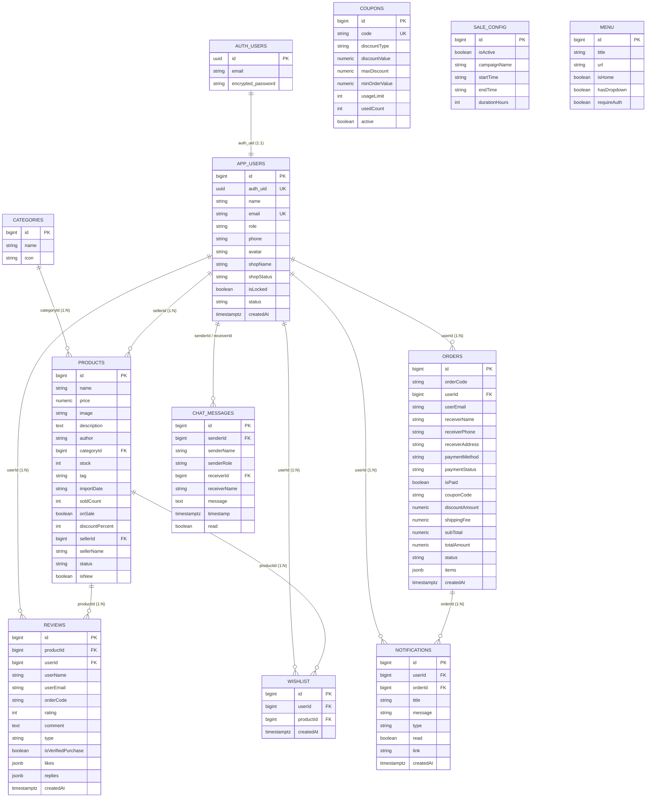

# 🗄️ Thiết Kế Cơ Sở Dữ Liệu — Hệ Thống Nhà Sách Online (BookStore)

> **Tài liệu kỹ thuật Database Schema & Bảo mật RLS**
> **Tác giả**: Nguyễn Văn Hiếu — MSSV: `501250367`
> **Kiến trúc lưu trữ chính**: **Supabase PostgreSQL** (Production) kết hợp **Supabase Auth (`auth.users`)**, **Row Level Security (RLS)**, **Database Triggers**, **Security-Definer RPCs**, **Supabase Storage (`uploads`)** và **Supabase Realtime**.
> **Môi trường Offline / Fallback**: `db.json` (`json-server`) khi chạy cục bộ không cấu hình biến môi trường Supabase.

---

## 1. Tổng quan Kiến trúc Cơ sở dữ liệu

Hệ thống sử dụng **PostgreSQL trên Supabase** gồm **11 bảng nghiệp vụ** trong schema `public`, liên kết chặt chẽ với bảng hệ thống `auth.users` của Supabase Auth thông qua cột `auth_uid` trên bảng `public.app_users`.

### Điểm nổi bật của thiết kế Production
1. **Tách biệt danh tính & hồ sơ**: `auth.users` quản lý xác thực (email, mật khẩu băm bcrypt, JWT, phiên đăng nhập, khôi phục mật khẩu qua email), còn `public.app_users` lưu hồ sơ người dùng, vai trò (`customer` / `seller` / `admin`), và thông tin cửa hàng (`shopName`, `shopStatus`).
2. **Bảo vệ ở tầng Database (RLS + Triggers)**:
   - Không tin tưởng dữ liệu role hay trạng thái khóa gửi từ client.
   - Trigger `on_auth_user_created` (`handle_new_auth_user()`) tự động đồng bộ user mới vào `app_users` với role mặc định an toàn.
   - Trigger `guard_app_user_update` chặn user tự nâng quyền (`role`) hoặc tự mở khóa (`isLocked`).
   - Trigger `guard_order_update` kiểm soát chuyển trạng thái đơn hàng theo vai trò.
3. **Lưu trữ tối ưu với JSONB**: `orders.items` và `reviews.likes` / `reviews.replies` dùng `JSONB` thay cho các bảng trung gian rườm rà, giúp truy vấn đơn hàng và đánh giá nhanh, đồng thời được thao tác nguyên tử (atomic) qua các hàm RPC `SECURITY DEFINER`.

---

## 2. Sơ đồ Thực thể Liên kết (ERD)

---

## 3. Từ điển Dữ liệu Chi tiết (11 Bảng `public`)

### 3.1. Bảng `public.app_users`
Lưu hồ sơ người dùng, phân quyền và thông tin cửa hàng của Seller.

| Cột | Kiểu dữ liệu | Ràng buộc | Mô tả |
| :--- | :--- | :--- | :--- |
| `id` | `BIGINT` | `PRIMARY KEY GENERATED BY DEFAULT AS IDENTITY` | Mã định danh nội bộ của người dùng |
| `auth_uid` | `UUID` | `UNIQUE REFERENCES auth.users(id)` | Liên kết 1-1 với tài khoản Supabase Auth |
| `name` | `TEXT` | `NOT NULL` | Họ tên hiển thị |
| `email` | `TEXT` | `UNIQUE NOT NULL` | Email đăng nhập |
| `password_hash` | `TEXT` | `Nullable` | Trường tương thích cũ (Supabase Auth giữ mật khẩu thật) |
| `role` | `TEXT` | `DEFAULT 'customer'` | `customer` \| `seller` \| `admin` |
| `phone` | `TEXT` | `Nullable` | Số điện thoại liên hệ |
| `gender` | `TEXT` | `Nullable` | Giới tính |
| `dob` | `TEXT` | `Nullable` | Ngày sinh |
| `address` | `TEXT` | `Nullable` | Địa chỉ giao hàng mặc định |
| `bio` | `TEXT` | `Nullable` | Giới thiệu bản thân |
| `avatar` | `TEXT` | `Nullable` | URL ảnh đại diện (Supabase Storage CDN) |
| `shopName` | `TEXT` | `Nullable` | Tên cửa hàng (dành cho `seller`) |
| `shopDescription` | `TEXT` | `Nullable` | Mô tả cửa hàng |
| `shopPhone` | `TEXT` | `Nullable` | Hotline cửa hàng |
| `shopAddress` | `TEXT` | `Nullable` | Địa chỉ kho/cửa hàng |
| `shopBio` | `TEXT` | `Nullable` | Tiểu sử gian hàng |
| `isLocked` | `BOOLEAN` | `DEFAULT false` | Cờ khóa tài khoản bởi Admin |
| `status` | `TEXT` | `DEFAULT 'active'` | Trạng thái hoạt động tài khoản |
| `shopStatus` | `TEXT` | `DEFAULT 'active'` | Trạng thái duyệt/hoạt động của shop |
| `createdAt` | `TIMESTAMPTZ` | `DEFAULT now()` | Thời điểm tạo hồ sơ |

---

### 3.2. Bảng `public.categories`
Danh mục phân loại sách hiển thị trên menu và bộ lọc trang chủ.

| Cột | Kiểu dữ liệu | Ràng buộc | Mô tả |
| :--- | :--- | :--- | :--- |
| `id` | `BIGINT` | `PRIMARY KEY` | Mã danh mục |
| `name` | `TEXT` | `NOT NULL` | Tên danh mục (Văn học, Kinh tế, Kỹ năng sống...) |
| `icon` | `TEXT` | `Nullable` | Icon biểu tượng hiển thị |

---

### 3.3. Bảng `public.products`
Kho sách kinh doanh trên hệ thống (hỗ trợ cả sách hệ thống và sách do Seller đăng bán).

| Cột | Kiểu dữ liệu | Ràng buộc | Mô tả |
| :--- | :--- | :--- | :--- |
| `id` | `BIGINT` | `PRIMARY KEY` | Mã sản phẩm |
| `name` | `TEXT` | `NOT NULL` | Tên sách |
| `price` | `NUMERIC` | `NOT NULL` | Giá bán niêm yết (VNĐ) |
| `image` | `TEXT` | `Nullable` | URL ảnh bìa (Storage CDN hoặc asset URL) |
| `description` | `TEXT` | `Nullable` | Mô tả chi tiết nội dung sách |
| `author` | `TEXT` | `Nullable` | Tên tác giả |
| `categoryId` | `BIGINT` | `REFERENCES categories(id)` | Mã danh mục |
| `stock` | `INTEGER` | `DEFAULT 0` | Số lượng tồn kho (trừ tự động qua RPC `place_order`) |
| `tag` | `TEXT` | `Nullable` | Nhãn nổi bật (`Hot`, `Bestseller`...) |
| `importDate` | `TEXT` | `Nullable` | Ngày nhập kho |
| `soldCount` | `INTEGER` | `DEFAULT 0` | Tổng số lượng đã bán |
| `onSale` | `BOOLEAN` | `DEFAULT false` | Cờ tham gia Flash Sale |
| `discountPercent` | `INTEGER` | `DEFAULT 0` | Phần trăm giảm giá (`0 - 100`) |
| `sellerId` | `BIGINT` | `Nullable` | ID người bán (`app_users.id`) |
| `sellerName` | `TEXT` | `Nullable` | Tên gian hàng/người bán |
| `status` | `TEXT` | `DEFAULT 'approved'` | Trạng thái kiểm duyệt (`approved`, `pending`, `rejected`) |
| `isNew` | `BOOLEAN` | `DEFAULT false` | Cờ đánh dấu sách mới phát hành |

---

### 3.4. Bảng `public.sale_config`
Cấu hình chiến dịch Flash Sale toàn sàn do Admin điều khiển.

| Cột | Kiểu dữ liệu | Ràng buộc | Mô tả |
| :--- | :--- | :--- | :--- |
| `id` | `BIGINT` | `PRIMARY KEY` | Mã cấu hình |
| `isActive` | `BOOLEAN` | `DEFAULT false` | Bật/tắt Flash Sale |
| `campaignName` | `TEXT` | `Nullable` | Tên chiến dịch khuyến mãi |
| `startTime` | `TEXT` | `Nullable` | Giờ bắt đầu |
| `endTime` | `TEXT` | `Nullable` | Giờ kết thúc |
| `startDate` | `TEXT` | `Nullable` | Ngày bắt đầu |
| `endDate` | `TEXT` | `Nullable` | Ngày kết thúc |
| `durationHours` | `INTEGER` | `Nullable` | Thời lượng chiến dịch (giờ) |
| `description` | `TEXT` | `Nullable` | Mô tả ngắn |

---

### 3.5. Bảng `public.coupons`
Quản lý mã giảm giá / voucher áp dụng tại bước thanh toán.

| Cột | Kiểu dữ liệu | Ràng buộc | Mô tả |
| :--- | :--- | :--- | :--- |
| `id` | `BIGINT` | `PRIMARY KEY` | Mã voucher |
| `code` | `TEXT` | `UNIQUE NOT NULL` | Mã nhập khi checkout (VD: `WELCOME10`) |
| `description` | `TEXT` | `Nullable` | Mô tả điều kiện áp dụng |
| `discountType` | `TEXT` | `NOT NULL` | `percent` (theo %) hoặc `fixed` (số tiền cố định) |
| `discountValue` | `NUMERIC` | `NOT NULL` | Giá trị giảm |
| `maxDiscount` | `NUMERIC` | `Nullable` | Mức giảm tối đa (nếu giảm theo %) |
| `minOrderValue` | `NUMERIC` | `DEFAULT 0` | Giá trị đơn hàng tối thiểu |
| `usageLimit` | `INTEGER` | `Nullable` | Số lượt dùng tối đa toàn hệ thống |
| `usedCount` | `INTEGER` | `DEFAULT 0` | Số lượt đã sử dụng (tăng qua RPC `place_order`) |
| `startsAt` | `TEXT` | `Nullable` | Thời gian bắt đầu hiệu lực |
| `expiresAt` | `TEXT` | `Nullable` | Thời gian hết hạn |
| `active` | `BOOLEAN` | `DEFAULT true` | Trạng thái kích hoạt |
| `createdAt` | `TIMESTAMPTZ` | `DEFAULT now()` | Ngày tạo |

---

### 3.6. Bảng `public.orders`
Lưu thông tin đơn hàng và danh sách sản phẩm mua dưới dạng `JSONB`.

| Cột | Kiểu dữ liệu | Ràng buộc | Mô tả |
| :--- | :--- | :--- | :--- |
| `id` | `BIGINT` | `PRIMARY KEY` | ID đơn hàng |
| `orderCode` | `TEXT` | `NOT NULL` | Mã đơn hàng tra cứu (VD: `ORD-...`) |
| `userId` | `BIGINT` | `Nullable` | ID người mua (`NULL` nếu khách vãng lai) |
| `userEmail` | `TEXT` | `Nullable` | Email nhận thông báo đơn |
| `receiverName` | `TEXT` | `NOT NULL` | Tên người nhận |
| `receiverPhone` | `TEXT` | `NOT NULL` | Số điện thoại người nhận |
| `receiverAddress` | `TEXT` | `NOT NULL` | Địa chỉ giao hàng |
| `receiverNote` | `TEXT` | `Nullable` | Ghi chú đơn hàng |
| `paymentMethod` | `TEXT` | `DEFAULT 'cod'` | `cod` hoặc `vietqr` (Demo Sandbox) |
| `paymentStatus` | `TEXT` | `DEFAULT 'unpaid'` | Trạng thái thanh toán (`unpaid`, `pending`, `paid`) |
| `isPaid` | `BOOLEAN` | `DEFAULT false` | Cờ đã thanh toán |
| `couponCode` | `TEXT` | `Nullable` | Mã giảm giá đã áp dụng |
| `discountAmount` | `NUMERIC` | `DEFAULT 0` | Số tiền được giảm |
| `shippingFee` | `NUMERIC` | `DEFAULT 0` | Phí vận chuyển |
| `subTotal` | `NUMERIC` | `DEFAULT 0` | Tạm tính trước giảm giá |
| `totalAmount` | `NUMERIC` | `NOT NULL` | Tổng tiền thanh toán cuối |
| `status` | `TEXT` | `DEFAULT 'Chờ xác nhận'` | `Chờ xác nhận (COD)` \| `Đang xử lý` \| `Đang giao hàng` \| `Hoàn thành` \| `Đã hủy` |
| `shippingCarrier` | `TEXT` | `DEFAULT ''` | Đơn vị vận chuyển bàn giao (`GHN`, `GHTK`, `Viettel Post`, `Giao nội thành 2H`) |
| `trackingCode` | `TEXT` | `DEFAULT ''` | Mã vận đơn để khách hàng và admin tra cứu |
| `shippedAt` | `TIMESTAMPTZ` | `Nullable` | Thời điểm bàn giao cho đơn vị vận chuyển |
| `items` | `JSONB` | `DEFAULT '[]'::jsonb` | Mảng các sản phẩm (`productId`, `name`, `price`, `quantity`, `image`, `sellerId`) |
| `createdAt` | `TIMESTAMPTZ` | `DEFAULT now()` | Thời gian đặt hàng |

---

### 3.7. Bảng `public.reviews`
Lưu đánh giá sao, bình luận, lượt thích (`likes` JSONB) và phản hồi lồng nhau (`replies` JSONB).

| Cột | Kiểu dữ liệu | Ràng buộc | Mô tả |
| :--- | :--- | :--- | :--- |
| `id` | `BIGINT` | `PRIMARY KEY` | ID đánh giá |
| `productId` | `BIGINT` | `NOT NULL` | ID sách được đánh giá |
| `userId` | `BIGINT` | `Nullable` | ID người viết đánh giá |
| `userName` | `TEXT` | `NOT NULL` | Tên người đánh giá |
| `userEmail` | `TEXT` | `Nullable` | Email người đánh giá |
| `orderCode` | `TEXT` | `Nullable` | Mã đơn hàng đối chiếu xác thực đã mua |
| `rating` | `INTEGER` | `Nullable` | Số sao (`1..5`, `NULL` nếu là bình luận hỏi đáp) |
| `comment` | `TEXT` | `NOT NULL` | Nội dung đánh giá / bình luận |
| `type` | `TEXT` | `DEFAULT 'comment'` | `review` (có chấm sao) hoặc `comment` |
| `isVerifiedPurchase` | `BOOLEAN` | `DEFAULT false` | Cờ xác nhận đã mua hàng (`true` nếu có đơn hợp lệ) |
| `likes` | `JSONB` | `DEFAULT '[]'::jsonb` | Mảng `userId` đã bấm Thích (cập nhật qua RPC `toggle_review_like`) |
| `replies` | `JSONB` | `DEFAULT '[]'::jsonb` | Mảng object phản hồi (`id`, `userId`, `userName`, `userRole`, `comment`, `createdAt`) |
| `createdAt` | `TIMESTAMPTZ` | `DEFAULT now()` | Thời gian tạo |

---

### 3.8. Bảng `public.wishlist`
Lưu danh sách sách yêu thích của từng tài khoản.

| Cột | Kiểu dữ liệu | Ràng buộc | Mô tả |
| :--- | :--- | :--- | :--- |
| `id` | `BIGINT` | `PRIMARY KEY` | ID bản ghi |
| `userId` | `BIGINT` | `NOT NULL` | ID người dùng |
| `productId` | `BIGINT` | `NOT NULL` | ID sách yêu thích |
| `createdAt` | `TIMESTAMPTZ` | `DEFAULT now()` | Ngày thêm |
| *(Constraint)* | `UNIQUE` | `("userId", "productId")` | Chống lưu trùng một sách nhiều lần |

---

### 3.9. Bảng `public.notifications`
Thông báo đơn hàng, cập nhật hệ thống (kích hoạt Supabase Realtime).

| Cột | Kiểu dữ liệu | Ràng buộc | Mô tả |
| :--- | :--- | :--- | :--- |
| `id` | `BIGINT` | `PRIMARY KEY` | ID thông báo |
| `userId` | `BIGINT` | `NOT NULL` | ID người nhận |
| `orderId` | `BIGINT` | `Nullable` | ID đơn hàng liên quan |
| `title` | `TEXT` | `NOT NULL` | Tiêu đề thông báo |
| `message` | `TEXT` | `NOT NULL` | Nội dung chi tiết |
| `type` | `TEXT` | `DEFAULT 'info'` | Loại thông báo (`order`, `system`, `promo`) |
| `read` | `BOOLEAN` | `DEFAULT false` | Đã đọc hay chưa |
| `link` | `TEXT` | `Nullable` | Đường dẫn điều hướng khi click |
| `createdAt` | `TIMESTAMPTZ` | `DEFAULT now()` | Thời điểm phát sinh |

---

### 3.10. Bảng `public.chat_messages`
Tin nhắn nội bộ trực tuyến giữa Customer — Seller — Admin (kích hoạt Supabase Realtime).

| Cột | Kiểu dữ liệu | Ràng buộc | Mô tả |
| :--- | :--- | :--- | :--- |
| `id` | `BIGINT` | `PRIMARY KEY` | ID tin nhắn |
| `senderId` | `BIGINT` | `NOT NULL` | ID người gửi |
| `senderName` | `TEXT` | `Nullable` | Tên người gửi |
| `senderRole` | `TEXT` | `Nullable` | Vai trò người gửi |
| `senderAvatar` | `TEXT` | `Nullable` | Ảnh đại diện người gửi |
| `receiverId` | `BIGINT` | `NOT NULL` | ID người nhận |
| `receiverName` | `TEXT` | `Nullable` | Tên người nhận |
| `message` | `TEXT` | `NOT NULL` | Nội dung tin nhắn |
| `timestamp` | `TIMESTAMPTZ` | `DEFAULT now()` | Thời điểm gửi |
| `read` | `BOOLEAN` | `DEFAULT false` | Trạng thái đã xem |

---

### 3.11. Bảng `public.menu`
Cấu hình thanh điều hướng chính của giao diện cửa hàng.

| Cột | Kiểu dữ liệu | Ràng buộc | Mô tả |
| :--- | :--- | :--- | :--- |
| `id` | `BIGINT` | `PRIMARY KEY` | ID mục menu |
| `title` | `TEXT` | `NOT NULL` | Nhãn hiển thị |
| `url` | `TEXT` | `NOT NULL` | Đường dẫn đích |
| `isHome` | `BOOLEAN` | `DEFAULT false` | Đánh dấu trang chủ |
| `hasDropdown` | `BOOLEAN` | `DEFAULT false` | Có menu con danh mục |
| `requireAuth` | `BOOLEAN` | `DEFAULT false` | Yêu cầu đăng nhập khi truy cập |

---

## 4. Hàm Hỗ trợ, Triggers & RPC Security-Definer

Toàn bộ phần logic nhạy cảm được thực thi ngay trong PostgreSQL tại [`supabase/schema.sql`](../supabase/schema.sql) và [`supabase/migration_real_auth.sql`](../supabase/migration_real_auth.sql):

### 4.1. Hàm định danh & phân quyền RLS
- `current_app_user_id()`: Tra cứu `app_users.id` từ `auth.uid()` trong JWT hiện tại.
- `current_app_role()`: Trả về vai trò (`customer` / `seller` / `admin`) của người dùng đang đăng nhập.
- `is_admin()`, `is_seller()`: Kiểm tra nhanh quyền ở tầng RLS policy.
- `sync_table_sequences()`: Đồng bộ `SERIAL/IDENTITY` sequence sau khi seed dữ liệu mẫu.

### 4.2. Database Triggers
- `on_auth_user_created` → `handle_new_auth_user()`: Tự động tạo bản ghi trong `public.app_users` khi đăng ký qua Supabase Auth, gán mặc định `role = 'customer'` (chống leo thang đặc quyền).
- `trg_guard_app_user_update` → `guard_app_user_update()`: Ngăn người dùng thường tự sửa cột `role`, `isLocked`, `status`, `shopStatus`, `auth_uid`. Chỉ Admin mới có quyền thay đổi các trường này.
- `trg_guard_order_update` → `guard_order_update()`: Kiểm soát quyền cập nhật đơn hàng theo vai trò (Customer chỉ được hủy đơn khi còn ở trạng thái cho phép; Admin/Seller cập nhật tiến trình giao hàng).

### 4.3. Các hàm RPC (`SECURITY DEFINER`)
| Tên RPC | Tham số | Chức năng & Cơ chế bảo vệ |
| :--- | :--- | :--- |
| `place_order(p_order JSONB)` | Thông tin đơn & `items` | Chạy trong transaction duy nhất: kiểm tra & áp dụng `coupons` (tăng `usedCount`), kiểm tra & trừ `products.stock`, tăng `products.soldCount`, lưu `orders` và trả về đơn hàng hoàn chỉnh. |
| `toggle_review_like(p_review_id BIGINT)` | ID đánh giá | Xác định `current_app_user_id()`, thêm/xóa ID khỏi mảng `reviews.likes` JSONB mà không cần mở quyền `UPDATE` toàn bảng `reviews`. |
| `add_review_reply(p_review_id BIGINT, p_comment TEXT)` | ID đánh giá, nội dung | Gắn thông tin người trả lời lấy trực tiếp từ `app_users` (kèm role xác thực) vào mảng `reviews.replies` JSONB. |
| `get_chat_contacts()` | *(không)* | Trả về danh sách liên hệ hợp lệ (`id`, `name`, `role`, `avatar`, `shopName`) cho hộp chat mà không làm lộ email, số điện thoại hay bảng `app_users` ra public. |
| `lookup_guest_order(p_order_code TEXT, p_phone TEXT)` | Mã đơn, SĐT | Cho phép khách vãng lai (chưa đăng nhập) tra cứu đúng 1 đơn hàng khi khớp đồng thời `orderCode` và `receiverPhone`. |

---

## 5. Chính sách Row Level Security (RLS), Storage & Realtime

### 5.1. Ma trận Bảo mật RLS tóm tắt
- **Công khai đọc (`SELECT` cho `anon` & `authenticated`)**: `categories`, `products`, `sale_config`, `coupons` (kiểm tra hợp lệ), `reviews`, `menu`.
- **Dữ liệu riêng tư theo chủ sở hữu**:
  - `app_users`: User chỉ đọc/sửa hồ sơ của chính mình; Admin đọc/cập nhật toàn bộ.
  - `orders`: User đọc đơn của mình; Seller xem đơn chứa sản phẩm của mình; Admin xem tất cả; Khách vãng lai chỉ tra cứu qua RPC `lookup_guest_order`.
  - `wishlist` & `notifications`: Chỉ chủ sở hữu (`userId = current_app_user_id()`) được đọc/thêm/sửa/xóa.
  - `chat_messages`: Chỉ `senderId` hoặc `receiverId` khớp với `current_app_user_id()` mới được đọc; chỉ được gửi với `senderId = current_app_user_id()`.

### 5.2. Supabase Storage (`uploads` bucket)
- Bucket `uploads` được cấu hình **Public Read (`SELECT`)** để tải ảnh bìa sách và avatar qua CDN.
- Chỉ người dùng đã xác thực (`authenticated`) mới được phép `INSERT`, `UPDATE`, `DELETE` tệp trong bucket này.

### 5.3. Supabase Realtime
- Bật publication `supabase_realtime` cho 2 bảng: `public.chat_messages` và `public.notifications` để nhận tin nhắn và thông báo đơn hàng tức thì không cần F5.

---

## 6. Tham chiếu Mã nguồn & Triển khai
- Schema đầy đủ & RLS/Triggers/RPC: [`supabase/schema.sql`](../supabase/schema.sql)
- Script migration nâng cấp Auth & RLS: [`supabase/migration_real_auth.sql`](../supabase/migration_real_auth.sql)
- Script khởi tạo dữ liệu mẫu (`seed`): [`supabase/seed.mjs`](../supabase/seed.mjs)
