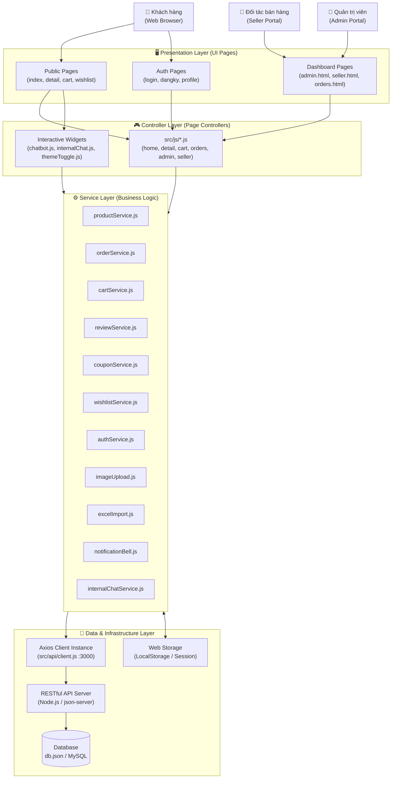
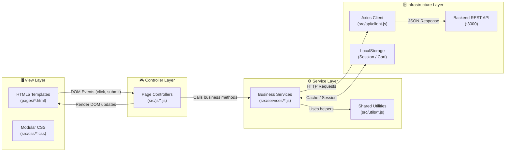
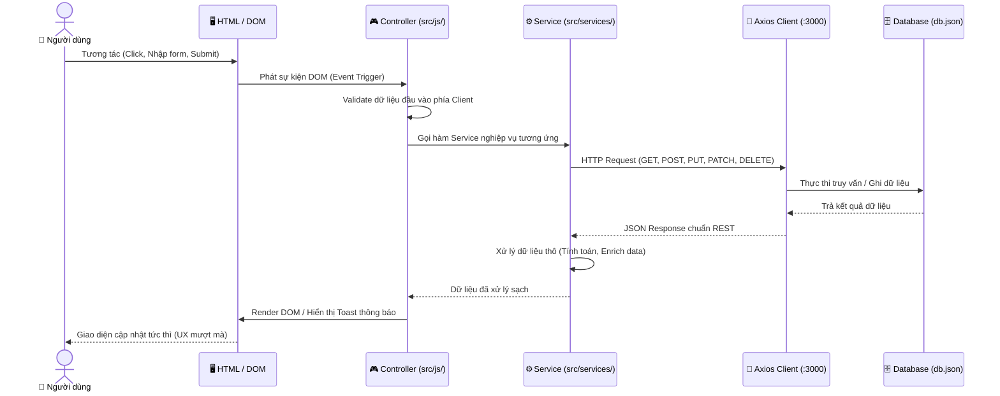
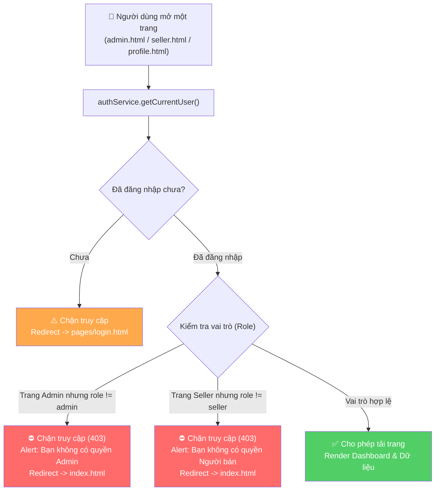
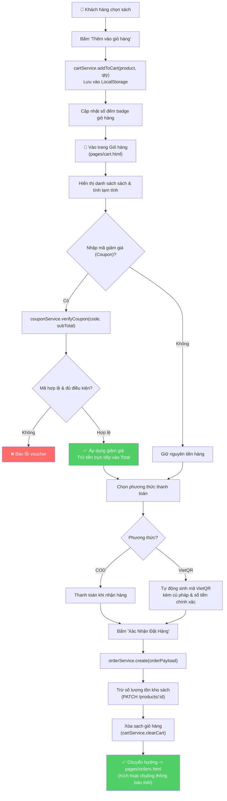
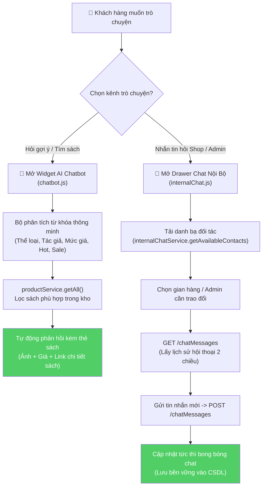
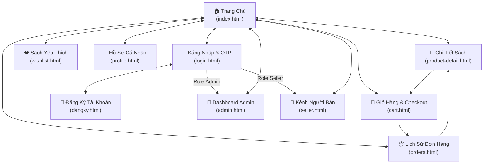

# 🏗️ Software Architecture Design — Nhà Sách Trí Tuệ Book

> [!NOTE]
> **Tài liệu Thiết Kế Kiến Trúc Phần Mềm (Software Architecture Design Document)** cho hệ thống Website Thương mại điện tử Nhà sách Trí Tuệ Book.
> 
> **Sinh viên thực hiện:** Nguyễn Văn Hiếu — **MSSV:** 501250367  
> **Học phần:** Lập trình JavaScript (JavaScript Programming)  
> **Hình thức:** Đồ án cá nhân (Individual Project)  
> **Mô hình kiến trúc:** Modular Layered Architecture (Multi-Page App + Modern ES6+ & RESTful Service Layer)

---

## 1. 🌐 High-Level System Architecture (Kiến Trúc Tổng Quan)

Hệ thống được thiết kế theo mô hình **Kiến trúc phân tầng hướng dịch vụ (Modular Layered Architecture)** nhằm đảm bảo tính độc lập, dễ kiểm thử và sẵn sàng tích hợp với bất kỳ nền tảng Backend nào (Node.js, Express, Docker, MySQL):



---

## 2. 📂 Project Directory Structure (Cấu Trúc Thư Mục Dự Án)

```text
nhasach/
├── pages/                          # Các trang giao diện con (Multi-Page Application)
│   ├── product-detail.html         # Trang Chi tiết sách & Luồng bình luận lồng nhau
│   ├── cart.html                   # Trang Giỏ hàng, Voucher & Thanh toán VietQR
│   ├── orders.html                 # Trang Lịch sử đơn hàng, Đánh giá nhận hàng & In PDF
│   ├── wishlist.html               # Trang Danh sách sách yêu thích (Thả tim)
│   ├── profile.html                # Trang Hồ sơ cá nhân & Upload ảnh đại diện
│   ├── seller.html                 # Kênh Người bán (Quản lý kho sách & đơn hàng Shop)
│   ├── admin.html                  # Dashboard Quản trị toàn sàn (5 Tabs quản trị)
│   ├── login.html                  # Đăng nhập phân quyền 3 vai trò & OTP Gmail
│   └── dangky.html                 # Đăng ký tài khoản người mua / gian hàng
│
├── src/                            # Mã nguồn ứng dụng (Core Source Code)
│   ├── api/                        # Tầng kết nối mạng
│   │   ├── client.js               # Cấu hình Axios instance tập trung (Port 3000)
│   │   └── auth.js                 # API xác thực tài khoản
│   ├── assets/                     # Tài nguyên hình ảnh, Logo SVG đối ngẫu Sáng/Tối
│   ├── css/                        # Tầng stylesheet theo mô-đun
│   │   ├── style.css               # Phong cách trang chủ & layout dùng chung
│   │   ├── dark-theme.css          # Giao diện tối Cosmic Obsidian toàn diện
│   │   ├── detail.css              # Giao diện trang chi tiết & tương tác bình luận
│   │   ├── cart.css                # Giao diện giỏ hàng & modal VietQR
│   │   ├── orders.css              # Giao diện đơn hàng & mẫu hóa đơn PDF
│   │   ├── wishlist.css            # Giao diện trang sách yêu thích
│   │   ├── profile.css             # Giao diện hồ sơ & avatar
│   │   ├── admin.css               # Giao diện bảng điều khiển Admin
│   │   ├── seller.css              # Giao diện Kênh Người Bán
│   │   ├── auth.css                # Giao diện đăng nhập, đăng ký & OTP
│   │   ├── chatbot.css             # Khung chat AI tư vấn sách thông minh
│   │   ├── internalChat.css        # Khung chat nội bộ giữa các thành viên
│   │   ├── notificationBell.css    # Chuông thông báo đơn hàng
│   │   └── excelImport.css         # Modal xem trước & nhập Excel
│   ├── services/                   # Tầng Dịch vụ (Business Logic & Data Access)
│   │   ├── productService.js       # CRUD sách, tồn kho, lọc sách, phân trang
│   │   ├── orderService.js         # Tạo đơn, cập nhật trạng thái đơn, hủy đơn
│   │   ├── cartService.js          # Quản lý giỏ hàng trên LocalStorage
│   │   ├── reviewService.js        # Đánh giá sao, bình luận tự do, like, reply
│   │   ├── wishlistService.js      # Lưu/xóa sách yêu thích theo tài khoản
│   │   ├── couponService.js        # Kiểm tra điều kiện & áp dụng mã giảm giá
│   │   ├── authService.js          # Đăng nhập, đăng ký, phân quyền, đổi mật khẩu
│   │   ├── imageUpload.js          # Chọn file ảnh, live preview & nén Base64
│   │   ├── excelImport.js          # Phân tích & nhập sách hàng loạt từ file .xlsx
│   │   ├── notificationBell.js     # Lắng nghe biến động đơn & đẩy thông báo chuông
│   │   ├── internalChatService.js  # Tải & lưu lịch sử hội thoại nội bộ
│   │   ├── saleService.js          # Quản lý chiến dịch Flash Sale & đếm ngược
│   │   └── categoryService.js      # Lấy danh mục thể loại sách
│   ├── utils/                      # Tầng tiện ích dùng chung
│   │   ├── format.js               # Định dạng tiền tệ VND, thời gian, escapeHtml
│   │   └── pagination.js           # Phân trang client-side dùng chung cho các bảng
│   └── js/                         # Tầng điều khiển giao diện (Page Controllers)
│       ├── home.js                 # Điều khiển trang chủ (Filter, Kệ sách, Sale)
│       ├── detail.js               # Điều khiển trang chi tiết, Like & Reply bình luận
│       ├── cart.js                 # Điều khiển giỏ hàng, Coupon & VietQR
│       ├── orders.js               # Điều khiển lịch sử đơn & xuất hóa đơn PDF
│       ├── wishlist.js             # Điều khiển danh sách sách yêu thích
│       ├── profile.js              # Điều khiển trang hồ sơ & avatar
│       ├── admin.js                # Điều khiển trang Admin, xuất Excel, quản lý Sale
│       ├── seller.js               # Điều khiển trang Seller & Import Excel
│       ├── chatbot.js              # Điều khiển Trợ lý AI tư vấn sách
│       ├── internalChat.js         # Điều khiển drawer chat trao đổi giữa các thành viên
│       └── themeToggle.js          # Chuyển đổi giao diện Sáng/Tối & chống chớp FOUC
│
├── index.html                      # Trang chủ (Entry Point)
├── db.json                         # Cơ sở dữ liệu REST API (Mock / Seed Database)
├── vite.config.js                  # Cấu hình đa trang (Multi-page App) của Vite
├── package.json                    # Khai báo thư viện & kịch bản chạy dự án
└── start.bat                       # Script 1-Click khởi động cả Backend và Frontend
```

---

## 3. 🧱 Layer Responsibility (Trách Nhiệm Từng Tầng Kiến Trúc)



| Tầng kiến trúc | Thành phần đại diện | Nhiệm vụ chính |
|:---|:---|:---|
| **View Layer** | HTML5, Modern CSS, Dark Theme | Hiển thị giao diện người dùng, cấu trúc trang, hiệu ứng chuyển động và hỗ trợ đa thiết bị Responsive. |
| **Controller Layer** | `src/js/*.js` | Bắt các sự kiện DOM từ người dùng, gọi Service tương ứng, nhận dữ liệu và thực hiện Render giao diện DOM động. |
| **Service Layer** | `src/services/*.js` | Đóng gói toàn bộ logic nghiệp vụ (tính tiền, áp voucher, tính sao trung bình, nén ảnh, xử lý Excel). |
| **Infrastructure Layer** | `api/client.js`, `storage.js` | Giao tiếp mạng qua HTTP Axios tới Backend `:3000`, quản lý bộ nhớ đệm `localStorage` (phiên đăng nhập, giỏ hàng). |

---

## 4. 🔄 Request-Response Workflow (Chu Trình Xử Lý Dữ Liệu)

Sơ đồ mô tả quy trình tuần tự chuẩn khi người dùng thực hiện bất kỳ hành động nào trên hệ thống:



---

## 5. 🔐 Multi-Role Authentication & Route Guard Flow (Xác Thực & Phân Quyền)

Hệ thống bảo vệ phân quyền 3 cấp độ (`customer`, `seller`, `admin`) và ngăn chặn truy cập trái phép vào các trang nhạy cảm:



---

## 6. 🛒 Shopping Cart, Coupon & VietQR Checkout Workflow



---

## 7. 🤖 Dual Chat Architecture (Hệ Thống Kênh Chat Kép)

Dự án sở hữu hai kênh chat phục vụ hai mục đích chuyên biệt:
1. **AI Chatbot:** Trợ lý tư vấn chọn sách thông minh 24/7 (Phân tích từ khóa tìm sách).
2. **Internal Member Chat:** Khung chat nội bộ giữa khách hàng và các gian hàng đối tác / Quản trị viên (Lưu trữ bền vững).



---

## 8. 🗺️ Page Navigation Map (Bản Đồ Điều Hướng Trang)



---

## 9. ⚡ Cross-Cutting Concerns & Technical Highlights (Các Điểm Nhấn Kỹ Thuật)

### 9.1. Chống chớp trắng màn hình (Anti-FOUC Mechanism)
- **Vấn đề:** Trình duyệt tải trang mặc định nền trắng, sau khi file CSS/JS ngoài nạp xong mới chuyển sang theme Tối $\rightarrow$ Gây chớp lóa mắt khó chịu.
- **Giải pháp kiến trúc:** Nhúng một đoạn mã JavaScript inline siêu ngắn ngay trong thẻ `<head>` của tất cả 9 trang HTML:
  ```javascript
  (function() {
      var m = localStorage.getItem('theme_mode');
      if (m === 'dark' || (!m && window.matchMedia && window.matchMedia('(prefers-color-scheme: dark)').matches)) {
          document.documentElement.classList.add('dark');
      }
  })();
  ```
  Nhờ đó theme Tối được kích hoạt ngay trước khi DOM bắt đầu render lần đầu tiên.

### 9.2. Tối ưu hóa hiệu năng DOM (Performance & Lazy Rendering)
- **Carousel Kệ sách trang chủ:** Áp dụng **Lazy Chunking** chỉ nạp 5 thẻ sách đầu tiên vào DOM mỗi kệ; phần còn lại chỉ được render khi người dùng cuộn ngang tới gần cuối hàng.
- **Tìm kiếm:** Áp dụng mô hình **Xem thêm (Load More)** hiển thị theo từng đợt 8 cuốn.
- **Bảng Quản trị Admin/Seller:** Áp dụng phân trang client-side độc lập (`src/utils/pagination.js`) cố định 10 bản ghi/trang, giúp bảng dữ liệu luôn mượt mà kể cả khi có hàng trăm đầu sách.

### 9.3. Xử lý xuất nhập dữ liệu hiện đại
- **Xuất PDF hóa đơn (`html2pdf.js`):** Định dạng A4 chuyên nghiệp, có logo nhà sách, bảng kê chi tiết và mã đơn hàng.
- **Xuất & Nhập Excel (`xlsx` - SheetJS):** 
  - Xuất toàn bộ báo cáo doanh thu và kho sách ra file `.xlsx`.
  - Đọc file Excel tải lên, kiểm tra tính hợp lệ dữ liệu (validate giá bán, tồn kho, thể loại) và xem trước bảng Preview trước khi cho phép nạp hàng loạt vào CSDL.

---

## 10. 🎯 Kết Luận

Tài liệu thiết kế kiến trúc phần mềm này:
1. Khẳng định tính chuẩn mực, sạch sẽ và có tổ chức cao của đồ án **Trí Tuệ Book**.
2. Chứng minh đầy đủ năng lực làm chủ kiến trúc phần mềm, tư duy phân tách tầng độc lập và làm chủ các công nghệ JavaScript hiện đại nhất.
3. Là tài liệu trung tâm hoàn hảo phục vụ cho việc thuyết trình, bảo vệ đồ án tốt nghiệp và bàn giao hệ thống!

