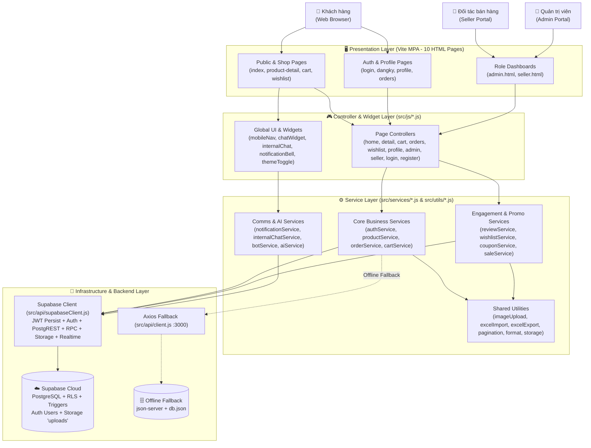
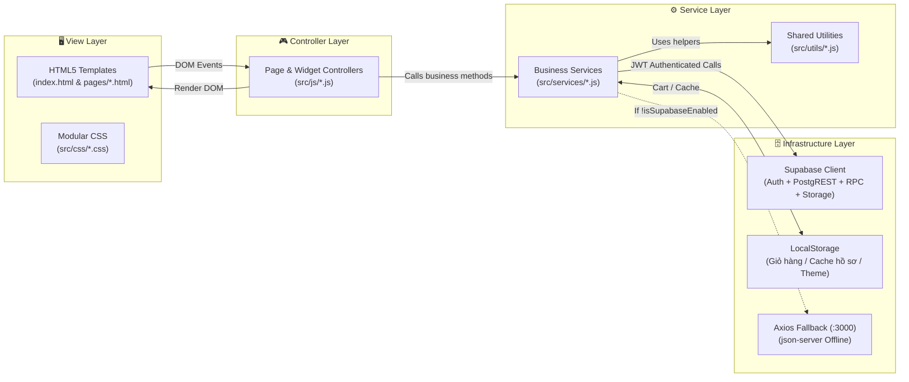
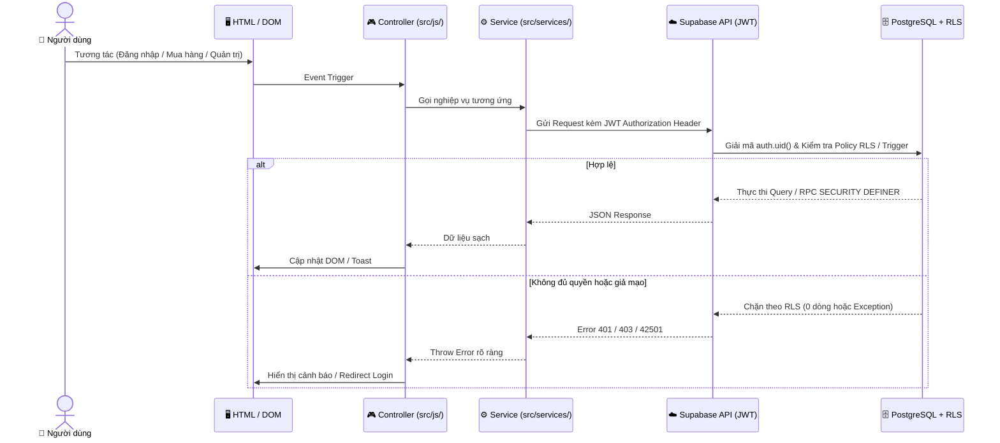
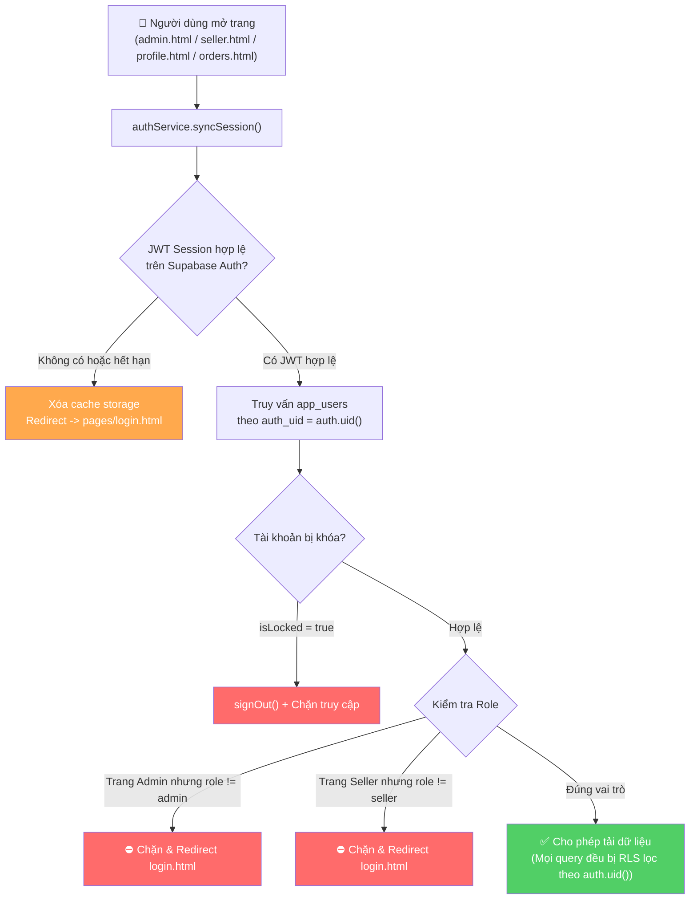
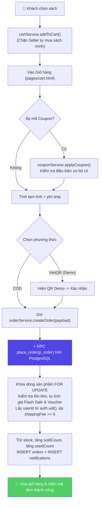
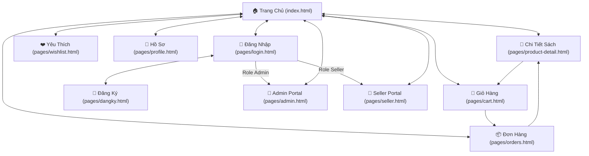

# 🏗️ Software Architecture Design — Nhà Sách Trí Tuệ Book

> [!NOTE]
> **Tài liệu Thiết Kế Kiến Trúc Phần Mềm (Software Architecture Design Document)** cho hệ thống Website Thương mại điện tử Nhà sách Trí Tuệ Book.
>
> **Sinh viên thực hiện:** Nguyễn Văn Hiếu — **MSSV:** 501250367  
> **Học phần:** Lập trình JavaScript (JavaScript Programming)  
> **Hình thức:** Đồ án cá nhân (Individual Project)  
> **Mô hình kiến trúc:** Modular Layered Architecture (Vite Multi-Page App + ES6+ Modules) kết nối **Supabase Backend** (PostgreSQL, Auth JWT, RLS, RPC, Storage, Realtime) và **Vercel Hosting** (hỗ trợ Offline Fallback qua `json-server`).

---

## 1. 🌐 High-Level System Architecture (Kiến Trúc Tổng Quan)

Hệ thống áp dụng mô hình **Kiến trúc phân tầng hướng dịch vụ (Modular Layered Architecture)** với hai đường truyền dữ liệu ở tầng Infrastructure: mặc định chạy trực tiếp với **Supabase Production Cloud** thông qua JWT xác thực và tự động fallback sang **`json-server` (:3000)** khi chạy offline.



---

## 2. 📂 Project Directory Structure (Cấu Trúc Thư Mục Dự Án)

```text
nhasach/
├── index.html                          # Trang chủ (Entry Point)
├── pages/                              # 9 trang chức năng độc lập (Multi-Page Application)
│   ├── product-detail.html             # Chi tiết sách, Đánh giá sao, Like & Reply lồng nhau
│   ├── cart.html                       # Giỏ hàng, Coupon & Thanh toán COD / VietQR Demo
│   ├── orders.html                     # Lịch sử đơn hàng, Đánh giá nhận hàng & In PDF
│   ├── wishlist.html                   # Sách yêu thích riêng tư theo tài khoản
│   ├── profile.html                    # Hồ sơ cá nhân, Upload Avatar & Đổi mật khẩu
│   ├── seller.html                     # Kênh Người bán (Kho sách, Đơn Shop & Import Excel)
│   ├── admin.html                      # Dashboard Quản trị toàn sàn
│   ├── login.html                      # Đăng nhập Supabase Auth & Quên mật khẩu Email thật
│   └── dangky.html                     # Đăng ký tài khoản Người mua / Gian hàng Seller
│
├── src/
│   ├── api/
│   │   ├── supabaseClient.js           # Client Supabase chính + createStatelessSupabaseClient()
│   │   └── client.js                   # Axios client dự phòng cổng 3000
│   ├── assets/                         # Logo SVG đối ngẫu (logo-light.svg, logo-dark.svg)
│   ├── css/                            # Stylesheet theo từng trang và thành phần
│   │   ├── style.css, dark-theme.css, mobile-nav.css, logo.css
│   │   ├── detail.css, cart.css, orders.css, wishlist.css, profile.css
│   │   ├── admin.css, seller.css, auth.css
│   │   └── chatbot.css, internalChat.css, notifications.css, excelImport.css
│   ├── services/                       # 14 Business & Data Access Services
│   │   ├── authService.js              # Supabase Auth JWT, syncSession, phân quyền, đổi pass
│   │   ├── productService.js           # CRUD sách, cập nhật tồn kho & lượt bán
│   │   ├── orderService.js             # Đặt hàng qua RPC place_order, cập nhật trạng thái, tra cứu
│   │   ├── categoryService.js          # Danh mục thể loại sách
│   │   ├── menuService.js              # Menu điều hướng động
│   │   ├── saleService.js              # Chiến dịch Flash Sale & tính giá giảm
│   │   ├── couponService.js            # Kiểm tra điều kiện & quản lý Voucher
│   │   ├── reviewService.js            # Đánh giá, Verified Purchase, toggleLike & addReply RPC
│   │   ├── wishlistService.js          # Quản lý sách yêu thích
│   │   ├── notificationService.js      # Chuông thông báo & đồng bộ Realtime
│   │   ├── internalChatService.js      # Danh bạ an toàn (get_chat_contacts RPC) & tin nhắn
│   │   ├── cartService.js              # Quản lý giỏ hàng theo user trên LocalStorage
│   │   ├── aiService.js                # Giao tiếp Google Gemini API
│   │   └── botService.js               # Chatbot AI tư vấn sách Lightweight RAG
│   ├── utils/                          # 6 Utilities dùng chung
│   │   ├── format.js                   # Format tiền VND, ngày giờ, escapeHtml
│   │   ├── storage.js                  # Cache hồ sơ user trên trình duyệt
│   │   ├── pagination.js               # Phân trang dùng chung
│   │   ├── imageUpload.js              # Nén ảnh Canvas + Upload Supabase Storage
│   │   ├── excelExport.js              # Xuất kho sách & doanh thu ra .xlsx
│   │   └── excelImport.js              # Đọc & kiểm tra file Excel .xlsx trước khi nhập kho
│   └── js/                             # 15 Page Controllers & Global UI Modules
│       ├── home.js, detail.js, cart.js, orders.js, wishlist.js, profile.js
│       ├── admin.js, seller.js, login.js, register.js
│       └── mobileNav.js, chatWidget.js, internalChat.js, notificationBell.js, themeToggle.js
│
├── supabase/
│   ├── schema.sql                      # Schema đầy đủ (11 bảng, Triggers, RPC, RLS, Storage)
│   ├── migration_real_auth.sql         # Migration nâng cấp Auth JWT + RLS cho DB hiện hữu
│   └── seed.mjs                        # Script đồng bộ auth.users + dữ liệu mẫu từ db.json
├── docs/                               # Tài liệu Kiến trúc, Database, API & Workflow
├── vite.config.js                      # Build config cho 10 HTML entry points
├── vercel.json                         # Static hosting & rewrite trên Vercel
└── package.json
```

---

## 3. 🧱 Layer Responsibility (Trách Nhiệm Từng Tầng Kiến Trúc)



| Tầng kiến trúc | Thành phần đại diện | Nhiệm vụ chính |
|:---|:---|:---|
| **View Layer** | HTML5, Modular CSS, Dark Theme, Mobile Nav | Giao diện 10 trang đa vai trò, Responsive Mobile Topbar 1 hàng & Drawer, chế độ Tối Cosmic Obsidian. |
| **Controller Layer** | `src/js/*.js` | Gọi `authService.syncSession()` kiểm tra JWT thật, lắng nghe DOM events, điều phối render & Realtime UI. |
| **Service Layer** | `src/services/*.js` + `src/utils/*.js` | Đóng gói nghiệp vụ; tự động ưu tiên gọi Supabase (RPC/PostgREST/Storage) và giữ khả năng fallback sang Axios nếu chạy offline. |
| **Infrastructure Layer** | `supabaseClient.js`, `client.js`, `storage.js` | Quản lý phiên JWT Supabase (`persistSession: true`), kết nối WebSocket Realtime, Storage CDN và LocalStorage. |

---

## 4. 🔄 Request-Response & Security Data Flow



---

## 5. 🔐 Multi-Role Authentication, Email Recovery & RLS Guard Flow

Khác với bản mock ban đầu chỉ kiểm tra `localStorage` ở client, hệ thống hiện tại bảo vệ **2 lớp** (UI Guard + Database RLS/Trigger):



- **Chống tự nâng quyền (Privilege Escalation Protection):** Trigger `handle_new_auth_user()` chỉ cho phép role `customer` hoặc `seller` khi tự đăng ký; Trigger `guard_app_user_update()` chặn mọi request không phải `admin` cố sửa `role`, `isLocked`, `status`, `shopStatus`.
- **Khôi phục mật khẩu thật:** Sử dụng `supabase.auth.resetPasswordForEmail()` gửi link có chữ ký một lần về hộp thư người dùng và kích hoạt sự kiện `PASSWORD_RECOVERY` trên `login.html`.

---

## 6. 🛒 Shopping Cart, Coupon & Atomic `place_order` Checkout Flow



---

## 7. 🤖 Dual Chat Architecture (AI RAG + Realtime Member Chat)

1. **AI Chatbot (`chatWidget.js` + `botService.js` + `aiService.js`):** Tư vấn sách dựa trên dữ liệu kho sách thực tế (Lightweight RAG kết hợp Google Gemini API do người dùng tùy chọn cấu hình key) và hỗ trợ tra cứu đơn hàng của tài khoản đang đăng nhập.
2. **Internal Member Chat (`internalChat.js` + `internalChatService.js`):**
   - Gọi RPC **`get_chat_contacts()`** chỉ trả về `id, name, role, avatar, shopName` (ẩn hoàn toàn email, số điện thoại, địa chỉ của người khác).
   - Tin nhắn lưu ở bảng `chat_messages` được RLS bảo vệ (`senderId = mình` hoặc `receiverId = mình`) và đồng bộ tức thì qua **Supabase Realtime**.

---

## 8. 🗺️ Page Navigation Map (10 Trang MPA)



---

## 9. ⚡ Cross-Cutting Concerns & Technical Highlights

1. **Anti-FOUC Dark Mode:** Script inline ngay trong `<head>` của cả 10 trang HTML đọc `localStorage.getItem('theme_mode')` để áp class `.dark` trước khi render.
2. **Unified Mobile Navigation (`mobileNav.js` & `mobile-nav.css`):** Tự động đồng bộ Header 1 hàng gọn trên mobile kèm Drawer trượt và phân quyền menu theo vai trò.
3. **Hiệu năng DOM:** Lazy Chunking cho kệ sách trang chủ, Load More khi tìm kiếm và Pagination dùng chung (`pagination.js`) cho các bảng dữ liệu lớn ở Admin/Seller.
4. **Xử lý Ảnh & Tài liệu:** Nén ảnh qua HTML5 Canvas rồi đẩy lên Supabase Storage (`imageUpload.js`); xuất hóa đơn A4 PDF (`html2pdf.js`); xuất/nhập kho Excel `.xlsx` (`xlsx`).
