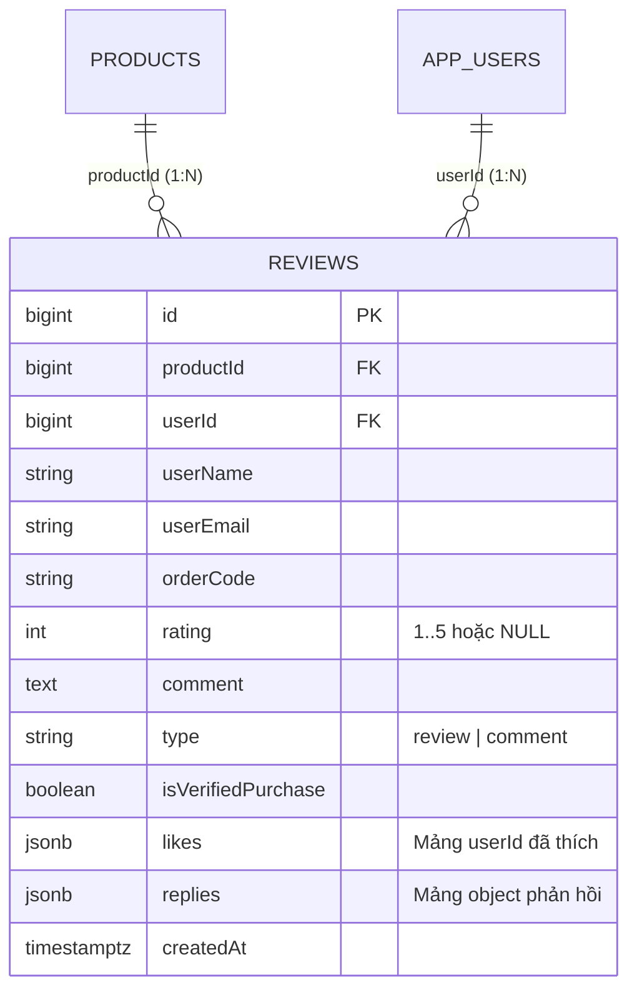
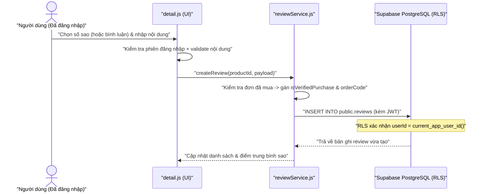
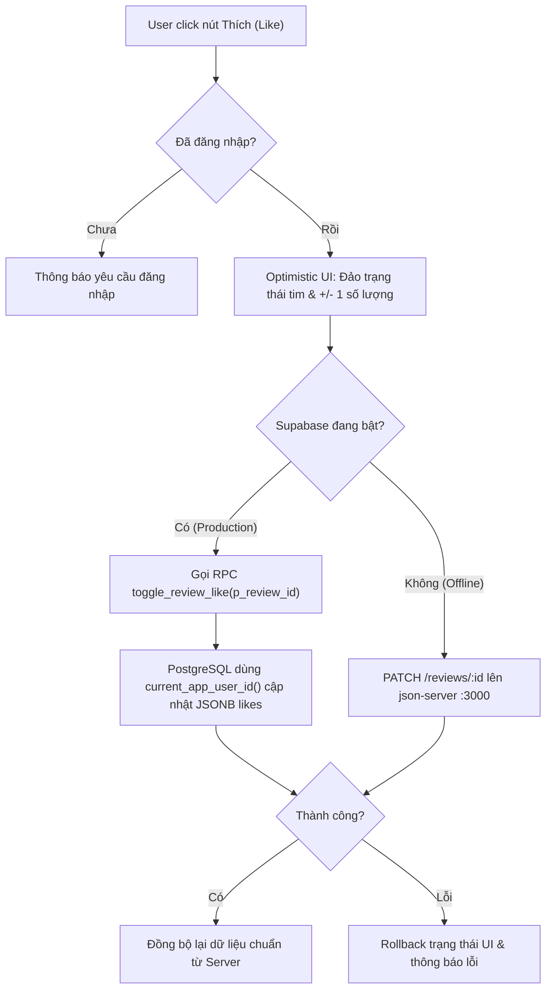
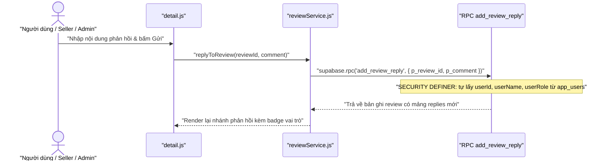

# 🔄 Tài Liệu Quy Trình Nghiệp Vụ — Đánh Giá, Bình Luận & Bảo Mật Dữ Liệu

> **Tác giả**: Nguyễn Văn Hiếu — MSSV: `501250367`
> **Phạm vi**: Mô tả luồng xử lý nghiệp vụ Đánh giá (Rating), Bình luận (Comment), Thích (Like), Trả lời (Reply) và cơ chế bảo mật RLS + RPC trên Supabase PostgreSQL (kèm chế độ Fallback Offline).

---

## 1. Tổng quan Kiến trúc Chức năng

Module tương tác trên trang chi tiết sách ([`pages/detail.html`](../pages/detail.html), [`src/js/detail.js`](../src/js/detail.js), [`src/services/reviewService.js`](../src/services/reviewService.js)) hỗ trợ 2 hình thức tương tác chính:

1. **Đánh giá sản phẩm (Review / Rating)**:
   - Chấm điểm từ **1 đến 5 sao** kèm nhận xét chi tiết.
   - Hệ thống tự động kiểm tra lịch sử đơn hàng của người dùng qua `orderService.js`; nếu đã mua sản phẩm ở đơn hợp lệ, bản ghi được gắn cờ `isVerifiedPurchase = true` và `orderCode` để hiển thị huy hiệu **"Đã mua hàng"**.
   - Tự động tính điểm trung bình (`rating`) và phân bố số sao.
2. **Bình luận & Hỏi đáp (Comment & Reply)**:
   - Người dùng đã đăng nhập có thể đặt câu hỏi (`type = 'comment'`, `rating = null`).
   - Hỗ trợ **Thả tim / Thích (`likes`)** và **Phản hồi lồng nhau (`replies`)** với badge vai trò (`Admin`, `Người bán`, `Khách hàng`).

---

## 2. Cấu trúc Dữ liệu Đánh giá (`public.reviews`)

Thay vì tách thành nhiều bảng phụ, `likes` và `replies` được lưu trực tiếp dưới dạng cột `JSONB` ngay trong bảng `public.reviews` để tối ưu tốc độ tải trang chi tiết sản phẩm:



### Cấu trúc mẫu các cột `JSONB`
- **`likes`**: `[12, 45, 89]` (danh sách `app_users.id`).
- **`replies`**:
```json
[
  {
    "id": 1731390000123,
    "userId": 2,
    "userName": "Quản trị viên",
    "userRole": "admin",
    "comment": "Cảm ơn bạn đã ủng hộ Nhà sách!",
    "createdAt": "2026-11-12T08:00:00.000Z"
  }
]
```

---

## 3. Luồng Xử lý Chi tiết

### 3.1. Luồng Gửi Đánh giá & Bình luận mới



### 3.2. Luồng Thả tim (`toggle_review_like`) với Optimistic UI

Để giao diện phản hồi tức thì, nút Like áp dụng **Optimistic UI**: cập nhật giao diện ngay lập tức trong bộ nhớ, đồng thời gọi RPC `toggle_review_like` để PostgreSQL cập nhật nguyên tử (atomic) mảng `likes` JSONB mà không cần cấp quyền `UPDATE` toàn bảng `reviews` cho user thường.



### 3.3. Luồng Phản hồi (`add_review_reply`)



---

## 4. Đảm bảo Bảo mật & Toàn vẹn Dữ liệu

1. **Chống giả mạo danh tính**: Người dùng không thể tự gửi `userId` hoặc `userRole` giả khi Reply hay Like, vì `toggle_review_like` và `add_review_reply` đọc trực tiếp danh tính từ JWT thông qua `current_app_user_id()`.
2. **Chống sửa/xóa trái phép**: Chính sách RLS trên bảng `reviews` chỉ cho phép chính chủ sở hữu (`userId = current_app_user_id()`) hoặc `admin` được xóa đánh giá; không cho phép user khác chỉnh sửa nội dung đánh giá của người khác.
3. **Hỗ trợ Offline Fallback**: Khi không có cấu hình Supabase, `reviewService.js` tự động chuyển sang gọi `client.js` (`http://localhost:3000/reviews`) để đảm bảo bài kiểm thử cục bộ vẫn hoạt động thông suốt.
