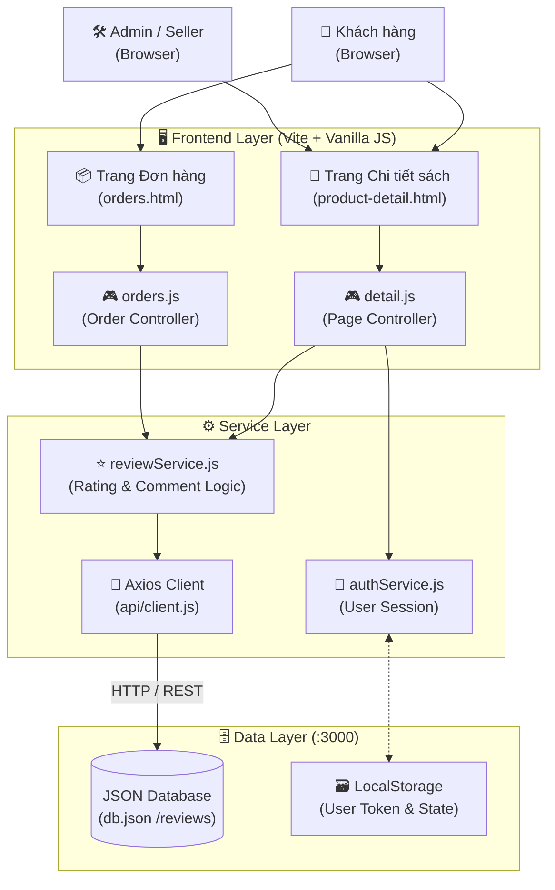
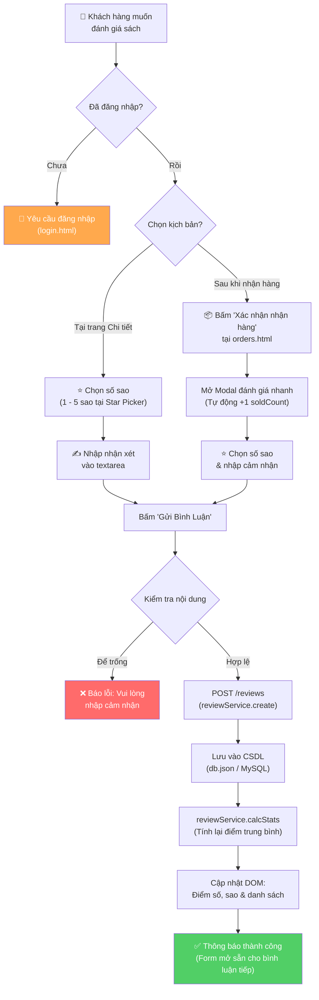
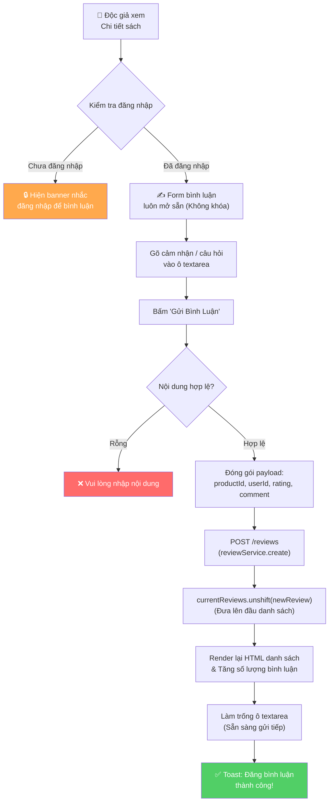
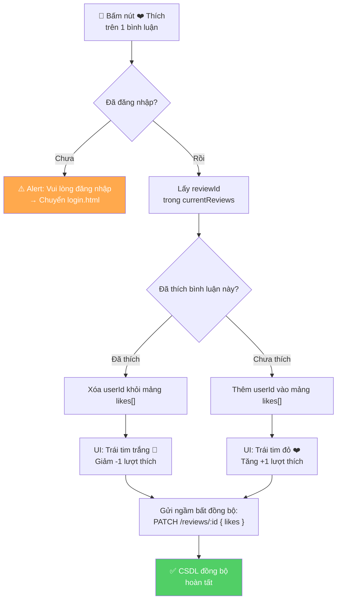
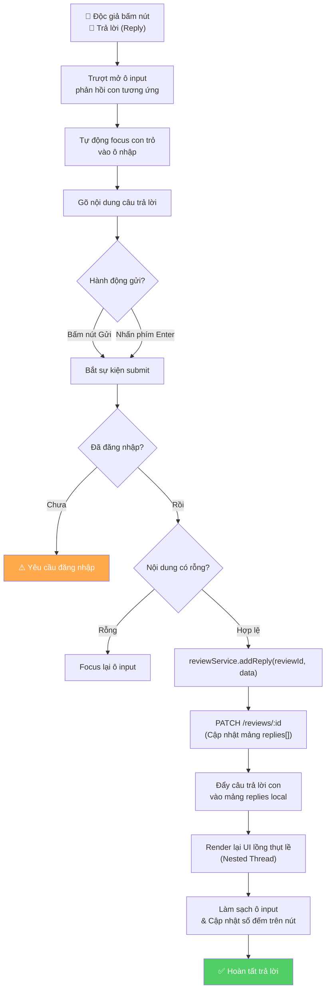
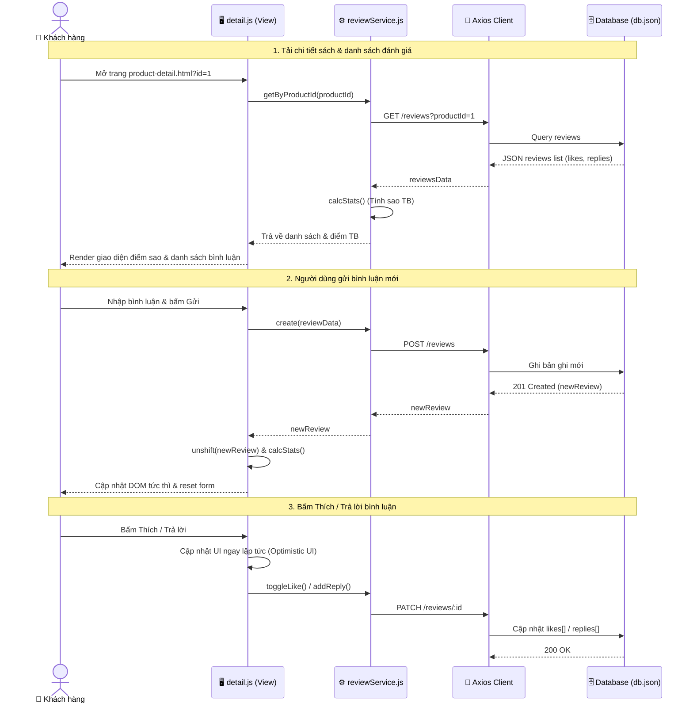
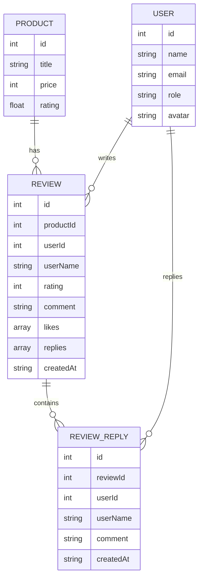

# 🔄 Software Workflow & Architecture Design — Đánh Giá & Bình Luận

> [!NOTE]
> Tài liệu thiết kế luồng nghiệp vụ (Workflow Design) và kiến trúc tương tác cho hệ thống **Đánh giá sao (Rating)** & **Bình luận đa cấp (Threaded Comments, Likes & Replies)** của dự án Nhà sách Trí Tuệ Book.
> 
> **Sinh viên thực hiện:** Nguyễn Văn Hiếu — **MSSV:** 501250367  
> **Môn học:** Lập trình JavaScript (JavaScript Programming)

---

## 1. 🌐 High-Level System Overview (Kiến Trúc Tổng Quan)

---

## 2. ⭐ Product Rating Workflow (Quy Trình Đánh Giá 1 - 5 Sao)

Quy trình đánh giá sản phẩm hỗ trợ 2 kịch bản:
- **Kịch bản A:** Đánh giá trực tiếp tại trang Chi tiết sách (`product-detail.html`).
- **Kịch bản B:** Đánh giá nhanh sau khi bấm *"Xác nhận đã nhận hàng"* tại trang Lịch sử đơn hàng (`orders.html`).

---

## 3. 💬 Product Comment Workflow (Bình Luận Tự Do Không Chặn Spam)

Độc giả có thể gửi nhiều bình luận, nhận xét hoặc đặt câu hỏi về sách tùy thích mà không bị khóa form như phiên bản cũ.

---

## 4. ❤️ Like & Unlike Comment Workflow (Thích Bình Luận Realtime)

Mỗi bình luận có nút tương tác Thích kèm bộ đếm số lượt thích tức thì.

---

## 5. ↪️ Threaded Reply Workflow (Trả Lời Bình Luận Lồng Nhau)

Hỗ trợ phản hồi trực tiếp dưới bất kỳ bình luận nào. Câu trả lời hiển thị lồng nhau với avatar và thời gian.

---

## 6. 🔄 Request-Response Sequence Diagram (Sơ Đồ Tuần Tự)

Sơ đồ mô tả chi tiết dòng chảy dữ liệu giữa Trình duyệt người dùng, Controller JavaScript, Service Layer và Backend Server:

---

## 7. 🗄️ Database Schema & Entities (Cấu Trúc Dữ Liệu Thực Tế)

Lược đồ mô tả quan hệ và các trường dữ liệu được lưu trữ trong `db.json`:

